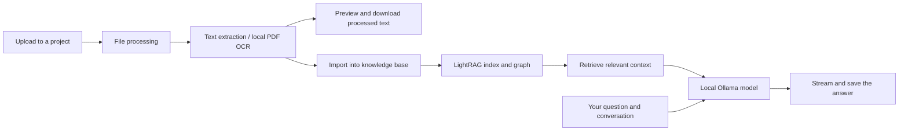

# Lumidoc

**Turn documents into searchable knowledge and conversations.**

**English** · [简体中文](./README.zh-CN.md)

Lumidoc is a self-hosted document workspace. Upload files, extract readable text
(including scanned PDF pages), organize them by project, and ask questions using
local AI models. The default Docker stack runs Ollama, storage, databases, and
application services on your own machine.

## What can I do with it?

| Your task | How Lumidoc helps |
| --- | --- |
| Find an answer buried in several files | Import processed documents into a project's knowledge base, then query it with LightRAG. |
| Read a scanned PDF | Extract its text with local OCR; preview and download the processed Markdown. |
| Keep work for different topics separate | Create projects with their own documents, knowledge bases, and conversations. |
| Ask follow-up questions | Continue a saved conversation; stop generation when needed. Replies can finish while you visit another page. |
| Explore connections between documents | Import documents into the knowledge base and inspect the extracted graph. Results depend on the document content and extraction quality. |
| Write something without using your files | Use chat for drafting and general questions, with or without document references. |

The interface supports English and Simplified Chinese. Conversation deletion is
synchronized between the sidebar and chat view. Document lists persist across
refreshes, and preview/download use the processed content rather than the original
upload.

Conversations inactive for 30 days are archived automatically as whole conversations
and remain accessible from the sidebar. No manual archive action is required.
You can add more processed documents to a knowledge base or delete an indexed
document from its file-status list. Removing it from the knowledge base preserves
the source file, so it can be imported again later.

## Administration

Administrators can open **Administration** from the sidebar to monitor service health,
loaded models, tasks and user access. The page supports English and Chinese and refreshes
every 10 seconds while visible. A failed refresh keeps the last snapshot and shows an
error; the check timestamp tells you how recent it is.

Service restart requires confirmation, interrupts in-flight requests and has a 60-second
cooldown. The internal `container_control` service only restarts allowlisted application
containers belonging to its own Compose project. Restart completion is separate from
health-check recovery. It cannot restart databases, storage, the gateway or the host.
If authentication or the gateway is unavailable, recover the stack from the terminal.

The controller is the only service with the Docker socket mounted and publishes no host
port. Docker socket access is privileged: deploy this controller only on a trusted host
([Docker security guidance](https://docs.docker.com/engine/security/)). Without a reachable
controller, monitoring continues and restart buttons are disabled. Recent restart results
are kept in controller memory; actor/service/result audit events go to its container logs.

## How it works



Uploading and knowledge-base import are separate steps. Chat retrieves document
context through LightRAG and generates a response through the LLM service.
The knowledge-base query panel uses hybrid retrieval. Model files are downloaded
on first startup; default PDF extraction and inference run locally afterward.
Optional model providers can be configured separately.

## Quick start

### Requirements

- Docker Engine or Docker Desktop, with Docker Compose v2 and a POSIX shell
  (Linux/macOS; use WSL2 on Windows).
- Internet access for the first image build, dependencies, and model downloads.
- Enough Docker memory and disk for the full stack. A practical starting point is
  **16 GB RAM and 30 GB free disk**; this is guidance, not a tested minimum.

### Start

From the repository directory:

```sh
./start_services.sh
```

On first run, the script creates a private `.env` with random credentials, builds
missing images, starts the services, downloads the configured models, and waits
for service health checks. It preserves an existing `.env` and existing data.
The first run can take several minutes, especially while downloading models.
MinIO is built from a pinned source release.

Open **[http://localhost:3000](http://localhost:3000)**, register an account, and:

1. Create a project.
2. Upload a document and wait for processing to complete.
3. Open the preview or download the processed text.
4. Import the document into the project's knowledge base.
5. Ask a question in chat or the knowledge-base query panel.

Default models: `qwen3:1.7b` for chat and `nomic-embed-text` for embeddings.
No host Python, Node.js, GPU, API key, or separate Ollama installation is required.

### Automatic GPU / CPU selection

`./start_services.sh` prefers a reachable native GPU Ollama, then a working Docker
NVIDIA GPU runtime, and otherwise starts Docker Ollama on CPU. On Apple Silicon,
install and start native Ollama to use Metal; an unavailable native server falls
back to CPU. On other hosts, native GPU use is detected from loaded models; Docker
NVIDIA acceleration requires the NVIDIA Container Toolkit.

Use `--native`, `--gpu`, or `--cpu` to force a mode (explicit choices do not silently
fall back). `--build` can be combined with any mode. Export `NATIVE_OLLAMA_URL` or
set it in `.env` to customize the native endpoint. The model initializer prepares
the configured models in the selected runtime. `./stop_services.sh` remembers the
last successful startup mode and preserves data volumes.

Native mode requires Compose support for `!reset`. Model requests keep models
loaded for 15 minutes (`OLLAMA_KEEP_ALIVE`) for faster subsequent requests.

Chat skips retrieval for greetings and independent writing requests, retains it for
document and ambiguous questions, and bounds recent history to 6,000 characters.
`CHAT_RETRIEVAL_TIMEOUT` defaults to 8 seconds; `CHAT_MAX_TOKENS` defaults to 512.
Increase these budgets if your documents or requested answers need more time/length.
Knowledge-base queries display a live answer stream and can be stopped.

### Update, inspect, and stop

```sh
./start_services.sh --build             # Rebuild after changing source code
docker compose ps                     # Check service state
docker compose logs --tail=100 fileproc_service
./stop_services.sh                     # Stop while preserving data volumes
```

If Docker is not running, start it first. For a failed first build, check network
access and free disk space, then rerun the startup command. `--wait` checks service
readiness; it does not prove every document or model response will succeed.

## Configuration and deployment scope

The generated `.env` follows [`.env.example`](./.env.example). Edit it for your
installation; never commit it. Existing installations with example/default
passwords should replace them deliberately—changing a database password in `.env`
alone does not migrate an existing database volume.

| Setting | Purpose |
| --- | --- |
| `OLLAMA_CHAT_MODEL` | Local chat and document post-processing model. |
| `OLLAMA_EMBEDDING_MODEL`, `OLLAMA_EMBEDDING_DIM` | Embedding model and dimension; rebuild knowledge indexes if these change. |
| `FILEPROC_CPU_LIMIT`, `FILEPROC_MEMORY_LIMIT` | File-processing limits, defaulting to 2 CPUs and 4 GB. |
| `LIGHTRAG_QUERY_MAX_TOKENS` | Knowledge-query answer budget, default 384. |
| `LIGHTRAG_QUERY_CONTEXT_TOKENS` | Knowledge-query context budget, default 4096. |
| `BIND_HOST` | Published port binding, default `127.0.0.1`. |

**The quick start is for local use.** Public access needs a separate deployment
review, TLS/reverse proxy, browser API address/CORS configuration, and restricted
infrastructure ports. Changing `BIND_HOST` alone is not a production deployment.
The frontend currently defaults to the local API gateway at port 8888.

## Current limitations

- OCR produces readable text; it does not preserve every table, formula, or page layout.
- Small local models can be slow or inaccurate. Check important answers against the source.
- Knowledge queries have a 120-second frontend timeout; large documents and CPU-only inference can exceed it.
- Graph completeness depends on indexing and extraction. Uploading alone does not build a knowledge graph.
- Background answers survive page navigation while services are running; worker/container crash recovery is not guaranteed.
- A successful local deployment is not a guarantee for every platform or network. Some base images and dependencies are not fully pinned.

## Repository map

```text
frontend/           React + TypeScript interface
src/modules/        Auth, projects, files, processing, chat, RAG, graph, gateway
src/shared/         Shared configuration, storage, service clients, model adapters
libs/LightRAG/      Vendored retrieval implementation
scripts/            Container setup and diagnostics
tests/             Backend regression tests
docker-compose.yml Full local stack
```

[Backend guide](./src/README.md) · [Frontend guide](./frontend/README.md) ·
[Scripts](./scripts/README.md) · [Development guide](./docs/DEVELOPMENT.md)

## Privacy and license

Local credentials, uploads, database files, OCR overrides, and assistant settings
are excluded from commits/build contexts. The default workflow uses local models;
configuring an external provider changes where document content may be sent.
Review logs before sharing them, as they can contain document or request details.

This repository uses a **[non-commercial license](./LICENSE)**. A public repository
does not grant unrestricted commercial use. Copyright notices and Git author
metadata remain part of the repository history.
