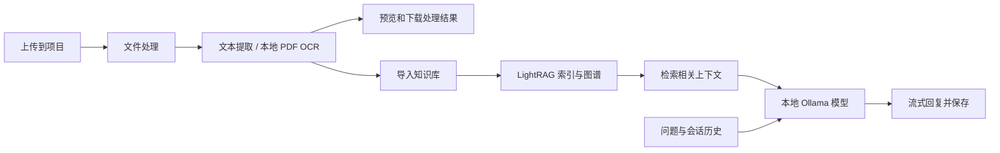

# Lumidoc

**把文档变成可检索、可对话的知识。**

[English](./README.md) · **简体中文**

Lumidoc 是一个可自行部署的文档工作台。上传文件、提取文本（包括扫描 PDF）、
按项目整理知识，然后使用本地 AI 提问。默认 Docker 部署包含 Ollama、文件存储、
数据库和应用服务，无需配置第三方模型 API。

## 它能解决什么问题？

| 你遇到的问题 | 可以怎样使用 Lumidoc |
| --- | --- |
| 文件太多，找不到需要的信息 | 将处理后的文档导入项目知识库，通过 LightRAG 检索并提问。 |
| 扫描 PDF 无法搜索、复制 | 本地 OCR 提取文字，在线预览并下载处理后的 Markdown。 |
| 不同工作的资料混在一起 | 为每个主题建立独立项目，分别管理文档、知识库和对话。 |
| 希望围绕同一主题连续追问 | 在一个会话中保存多轮问答；可以停止生成，切换页面后回复仍可继续完成。 |
| 想了解资料之间的关联 | 导入知识库后查看提取出的知识图谱，效果取决于文档内容与提取质量。 |
| 只想写文案，不需要引用文档 | 使用聊天进行普通问答和创作，并说明是否需要参考资料。 |

界面支持中英文切换。删除会话时，左侧历史与聊天区同步更新；文档列表在刷新后保留，
预览和下载使用处理后的文本。

## 从文件到回答



**上传文件和导入知识库是两个步骤。** 聊天通过 LightRAG 检索文档上下文，再由 LLM
服务生成回答；知识库查询面板使用 hybrid 检索。首次启动需要下载模型，之后默认的
PDF 提取和模型推理在本地运行。也可另外配置外部模型供应商。

## 快速开始

### 准备环境

- Docker Engine 或 Docker Desktop，包含 Docker Compose v2。
- POSIX shell：Linux/macOS 可直接运行，Windows 请使用 WSL2。
- 首次构建需要联网下载镜像、依赖和模型。
- 为完整服务栈预留足够资源：建议从 **16 GB 内存、30 GB 可用磁盘**起步，
  这是配置建议，并非经过验证的最低要求。

### 一条命令启动

在仓库目录执行：

```sh
./start_services.sh
```

首次运行会创建仅当前用户可读的 `.env`，生成随机凭据，构建缺失镜像、启动服务、
准备模型，并等待健康检查。已有 `.env` 和数据不会被覆盖。首次下载模型可能需要
几分钟或更久；MinIO 从固定版本的源码构建。

打开 **[http://localhost:3000](http://localhost:3000)**，注册账户，然后：

1. 创建项目。
2. 上传文档，等待处理完成。
3. 预览或下载处理后的文字。
4. 将文档导入该项目的知识库。
5. 在聊天区或知识库查询面板提问。

默认对话模型为 `qwen3:1.7b`，嵌入模型为 `nomic-embed-text`。
宿主机无需额外安装 Python、Node.js、Ollama，也不要求 GPU 或付费 API key。

### 自动选择 GPU / CPU

直接运行 `./start_services.sh`：优先使用可连接的原生 GPU Ollama，其次使用通过检测的
Docker NVIDIA GPU，均不可用时自动回退到 Docker CPU。
Apple Silicon Mac 需要安装并启动原生 Ollama 才能使用 Metal；原生服务不可用时回退到 CPU。
其他主机通过已加载模型检测原生 GPU；Docker NVIDIA 模式需要 NVIDIA Container Toolkit。

可用 `--native`、`--gpu` 或 `--cpu` 强制指定模式（显式指定时不会静默回退），
并可搭配 `--build`。通过环境变量或 `.env` 中的 `NATIVE_OLLAMA_URL` 自定义原生服务地址。
模型初始化服务会在选定的运行环境中准备模型。
`./stop_services.sh` 自动使用上次成功启动的模式，保留全部数据卷。
原生模式要求 Compose 支持 `!reset` 覆盖标签。

默认将模型保留在内存 15 分钟（`OLLAMA_KEEP_ALIVE`），以增加内存占用换取后续响应速度。
普通问候和独立写作请求跳过检索，文档问题和不明确的问题仍会检索。
历史上下文限制为最近 6 条、总计 6,000 字符；检索等待默认 8 秒（`CHAT_RETRIEVAL_TIMEOUT`），
回答预算默认 512 token（`CHAT_MAX_TOKENS`）。需要长回答或较慢检索时可提高这些配置。
知识库查询支持流式显示和停止生成。

### 更新、查看状态与关闭

```sh
./start_services.sh --build             # 修改源码后重新构建
docker compose ps                     # 查看服务状态
docker compose logs --tail=100 fileproc_service
./stop_services.sh                     # 停止服务，保留数据卷
```

Docker 未运行时请先启动。首次构建失败可检查网络和磁盘后重试。
健康检查通过代表服务已就绪，不代表每份文档或每次模型生成都一定成功。

## 配置与部署范围

生成的 `.env` 以 [`.env.example`](./.env.example) 为模板，请按需修改，切勿提交。
已有安装若仍使用示例密码，应安排更换；仅修改 `.env` 不会同步修改已有数据库卷中的密码。

| 配置 | 用途 |
| --- | --- |
| `OLLAMA_CHAT_MODEL` | 本地对话及文档后处理模型。 |
| `OLLAMA_EMBEDDING_MODEL`、`OLLAMA_EMBEDDING_DIM` | 嵌入模型及维度，修改后需要重建知识索引。 |
| `FILEPROC_CPU_LIMIT`、`FILEPROC_MEMORY_LIMIT` | 文件处理资源限制，默认 2 核、4 GB。 |
| `LIGHTRAG_QUERY_MAX_TOKENS` | 知识库回答长度预算，默认 384。 |
| `LIGHTRAG_QUERY_CONTEXT_TOKENS` | 知识库上下文预算，默认 4096。 |
| `BIND_HOST` | 对外端口绑定地址，默认 `127.0.0.1`。 |

**快速启动面向本机使用。** 公网部署还需要检查 TLS/反向代理、浏览器 API 地址、
CORS 以及基础设施端口访问控制。只修改 `BIND_HOST` 不等于完成生产部署。
前端默认连接本机 8888 端口的 API 网关。

## 当前限制

- OCR 输出可读文字，不能完整保留所有表格、公式和页面布局。
- 小型本地模型可能较慢或产生错误，重要答案请核对原文。
- 知识库查询前端超时为 120 秒，大文档或 CPU 推理可能超过此时间。
- 图谱完整度取决于索引和提取效果；上传文件本身不会自动生成知识图谱。
- 服务正常运行时，离开页面不影响后台回答；尚不保证进程或容器崩溃后的任务恢复。
- 本机部署通过不代表所有平台、网络都能保证成功；部分基础镜像和依赖尚未完全锁定版本。

## 代码在哪里？

```text
frontend/           React + TypeScript 界面
src/modules/        认证、项目、文件、处理、聊天、RAG、图谱和网关
src/shared/         配置、存储、服务客户端和模型适配器
libs/LightRAG/      仓库内的检索实现
scripts/            容器初始化和诊断脚本
tests/              后端回归测试
docker-compose.yml 完整本地服务栈
```

[后端说明](./src/README.md) · [前端说明](./frontend/README.md) ·
[脚本说明](./scripts/README.md) · [开发指南](./docs/DEVELOPMENT.md)

## 隐私与许可证

本地凭据、上传文件、数据库、OCR 自定义模型和助手配置不会进入提交或构建上下文。
默认工作流程使用本地模型，改用外部供应商后，文档内容的发送位置也会改变。
分享日志前请检查其中是否含文档或请求信息。

本项目采用 **[非商业使用许可证](./LICENSE)**。仓库公开不代表允许无限制商业使用。
版权声明和 Git 作者元数据仍保留在仓库及历史中。
