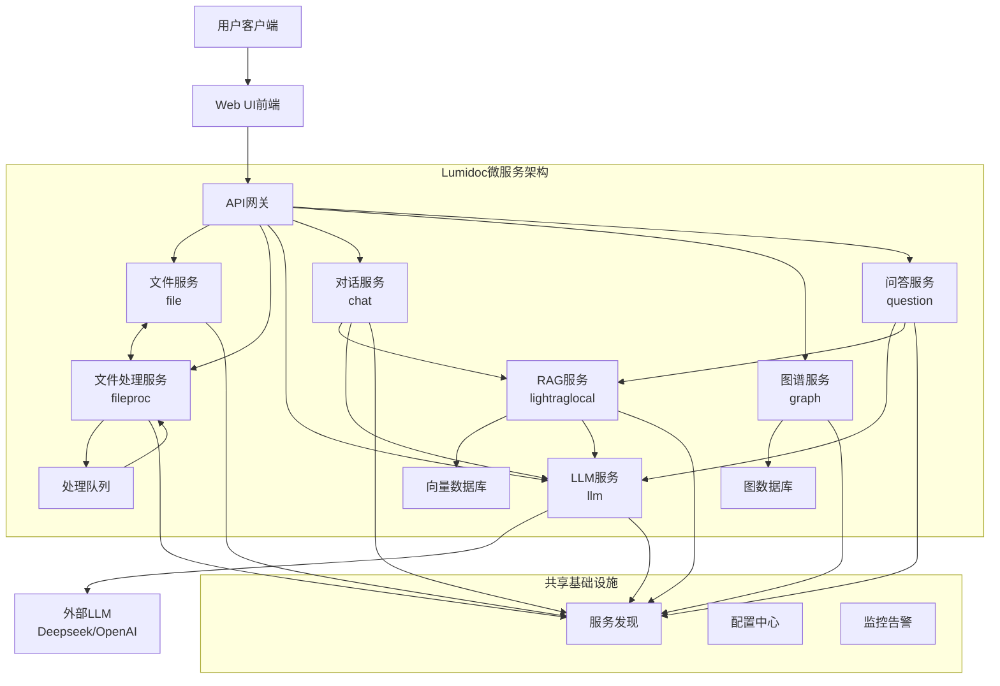
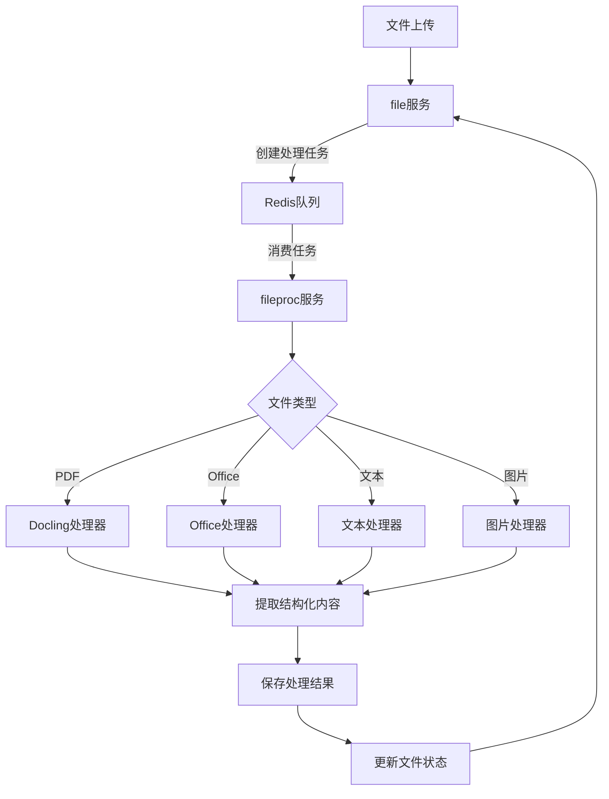
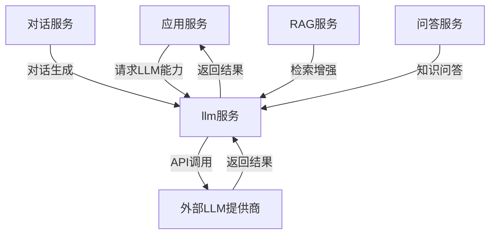

# Lumidoc项目微服务模块目录

此目录包含Lumidoc平台的所有微服务模块，每个子目录对应一个独立的微服务，采用严格的微服务架构原则设计。

## 微服务架构图



## 模块结构

```
modules/
├── auth/                # 认证授权服务
├── chat/                # 聊天会话服务 
├── file/                # 文件存储管理服务
├── fileproc/            # 文件处理服务
├── graph/               # 知识图谱服务
├── llm/                 # LLM大语言模型服务
├── lightraglocal/       # RAG检索增强生成服务
├── monitoring/          # 监控与告警服务
├── project/             # 项目管理服务
└── question/            # 问答管理服务
```

## 文件处理流程



## LLM服务交互流程



## 模块职责划分

### 认证授权服务 (auth)

提供统一的身份认证、授权和用户管理，支持JWT、多租户和权限管理。

- **核心职责**: 用户身份验证与权限控制
- **API接口**: 登录、注册、令牌刷新、权限验证
- **技术实现**: JWT、OAuth2.0、RBAC权限模型

### 聊天会话服务 (chat)

管理用户与AI助手的对话上下文，支持多轮对话、会话记忆和对话检索。

- **核心职责**: 对话管理、上下文维护、会话历史
- **依赖服务**: llm、lightraglocal
- **技术实现**: 基于Redis的会话存储、上下文窗口管理

### 文件存储管理服务 (file)

负责文件的上传、存储和元数据管理，提供统一的存储接口和文件组织功能。

- **核心职责**: 文件的物理存储和元数据维护
- **API接口**: 文件上传、下载、元数据管理
- **技术实现**: 本地文件系统、数据库元数据索引

### 文件处理服务 (fileproc)

负责文件内容的异步处理、转换和分析，基于消息队列的分布式任务系统。

- **核心职责**: 文件内容提取、格式转换、文本分析
- **处理器**: PDF处理器(Docling)、Office处理器、文本处理器
- **技术实现**: Redis队列、异步任务处理、流式文件处理

### 知识图谱服务 (graph)

构建和管理知识图谱，支持实体关系抽取、图谱查询和可视化。

- **核心职责**: 图谱构建、实体关系管理、图谱查询
- **技术实现**: Neo4j图数据库、关系抽取算法

### LLM大语言模型服务 (llm)

提供大语言模型任务的高级抽象，封装特定业务场景的LLM能力。

- **核心职责**: 模型访问统一抽象、特定任务接口、提示词模板、业务逻辑
- **模型支持**: Deepseek、OpenAI、Azure、Ollama等
- **支持任务**: 摘要生成、问题回答、内容分类等
- **技术实现**: 模型参数管理、流式响应处理

### RAG检索服务 (lightraglocal)

实现基于检索增强的生成系统，支持文档检索、上下文整合和响应生成。

- **核心职责**: 文档检索、向量搜索、上下文增强
- **依赖服务**: llm、向量数据库
- **技术实现**: 混合检索、重排序、上下文组装

### 监控与告警服务 (monitoring)

监控系统健康状态、性能指标，提供日志聚合和告警通知。

- **核心职责**: 服务监控、性能跟踪、日志管理
- **技术实现**: 指标收集、告警规则、仪表盘

### 项目管理服务 (project)

管理用户项目、团队协作和资源组织，支持项目级别的隔离和权限控制。

- **核心职责**: 项目创建、团队管理、资源组织
- **依赖服务**: auth
- **技术实现**: 多租户隔离、项目级资源控制

### 问答管理服务 (question)

管理用户提问和AI回答，支持问题分类、标签管理和检索。

- **核心职责**: 问题管理、回答生成、知识分类
- **依赖服务**: llm、lightraglocal
- **技术实现**: 问题分类、相似问题检索

## 微服务架构特性

- **服务独立性**: 每个服务只负责单一职责，不干涉其他服务内部实现
- **服务发现**: 所有服务通过Redis自动注册与发现
- **健康检查**: 每个服务提供标准化/healthz健康检查端点
- **API一致性**: 遵循统一的API设计规范，使用TRoute接口定义
- **无状态设计**: 服务支持水平扩展和高可用，状态存储在Redis或数据库
- **可观测性**: 统一的日志、监控和追踪机制
- **故障隔离**: 服务间故障不会级联传播
- **优雅降级**: 依赖服务不可用时保持基本功能

## 模块依赖关系

- `chat` → `llm`, `lightraglocal`
- `lightraglocal` → `llm`
- `question` → `llm`, `lightraglocal`
- `file` ↔ `fileproc` (双向调用)

## 服务间通信

服务间通信统一使用共享的ServiceClient模块：

```python
from src.shared.client.service_client import ServiceClient

async def call_another_service():
    client = await ServiceClient.get_instance()
    
    # 调用文件服务API
    result = await client.call_api(
        service_name="file",  # 服务名称
        path="api/files",     # API路径
        method="GET",         # HTTP方法
        use_service_auth=True # 使用服务间认证
    )
    
    return result
```

## 微服务开发规范

1. **命名规范**:
   - 接口使用I前缀（如IUserService）
   - 类型使用T前缀（如TUserData）
   - 组件使用PascalCase
   - 函数使用camelCase
   - 常量使用UPPER_CASE

2. **错误处理**:
   - 使用统一的错误类型和处理机制
   - 所有错误响应格式一致
   - 实现错误码映射和本地化错误消息

3. **服务注册**:
   - 服务启动时必须调用注册
   - 服务关闭时必须调用注销
   - 定期发送心跳保持服务状态更新

4. **异步编程**:
   - 所有IO操作必须使用异步模式
   - 正确处理异步异常
   - 避免阻塞事件循环

5. **文档与注释**:
   - 所有说明文档与注释必须使用中文
   - 复杂逻辑必须添加详细注释
   - 每个模块需要README.md文档 