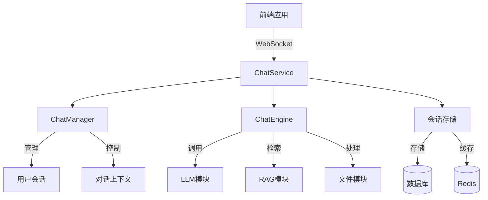
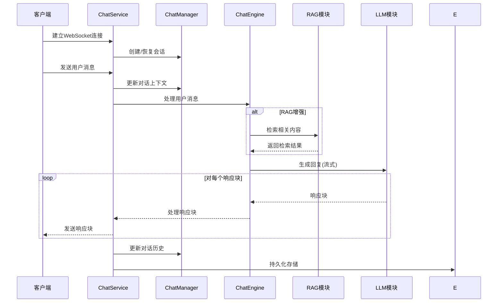
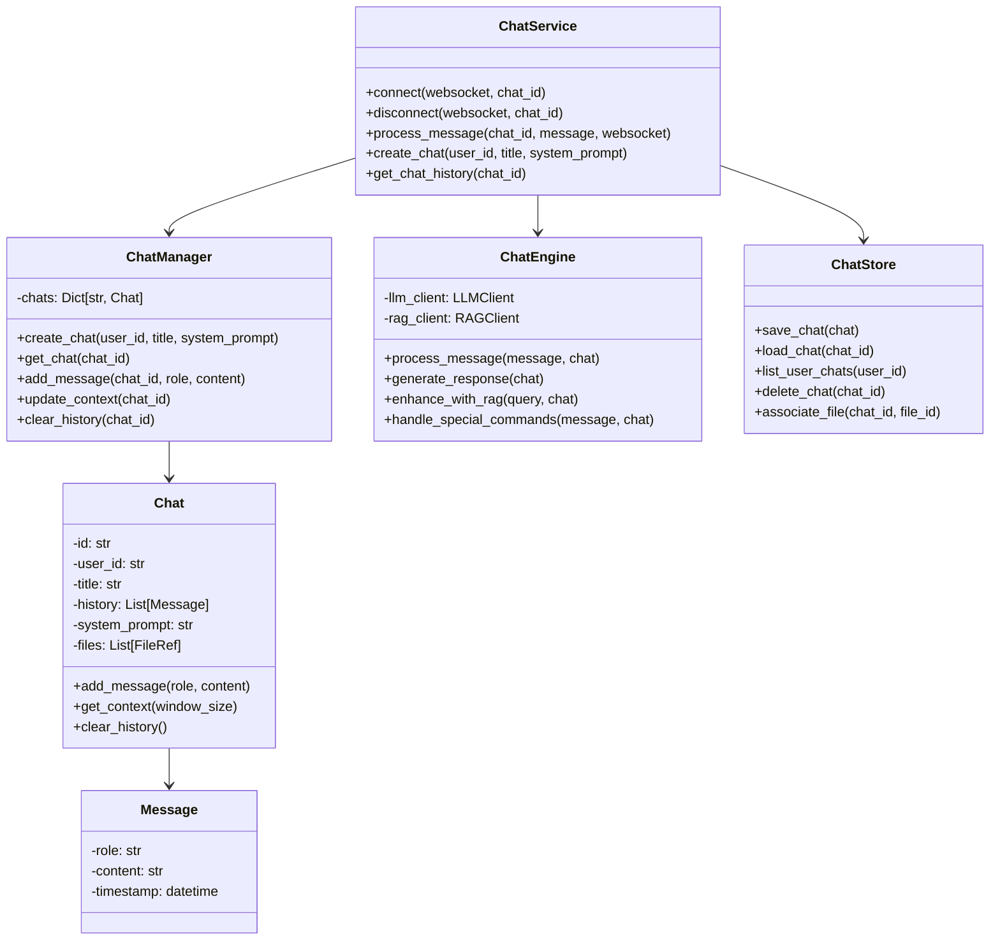
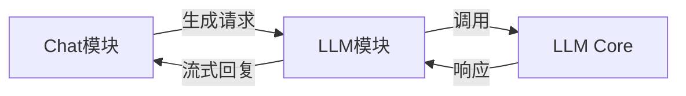
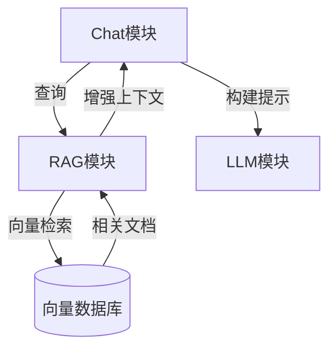
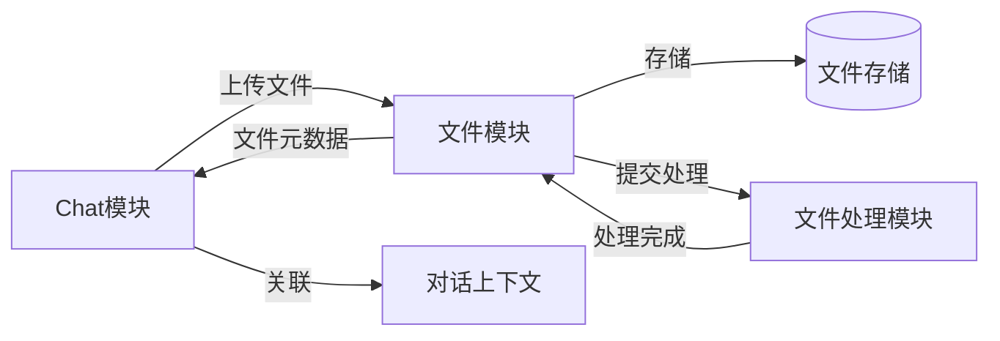

# Chat 对话服务模块

## 概述

`chat` 模块是STP平台的对话服务，负责管理用户对话、整合检索增强生成(RAG)和大语言模型(LLM)能力，为用户提供智能对话体验。该模块作为前端与后端AI能力的桥梁，协调各个服务模块共同完成复杂的对话任务。

## 模块架构



## 对话流程



## 主要功能

- **对话管理**: 创建、存储和管理用户对话上下文
- **消息处理**: 解析用户输入，处理特殊格式和命令
- **上下文增强**: 通过RAG检索相关知识，增强LLM响应质量
- **流式响应**: 支持LLM的流式输出，提升用户体验
- **多模态支持**: 处理文本、图片等多种输入类型
- **会话持久化**: 保存对话历史，支持会话恢复
- **对话控制**: 提供上下文管理和特殊指令支持

## 组件设计



## 核心组件

### 1. ChatService (chat_service.py)

核心服务类，提供:
- **连接管理**: WebSocket连接的建立和维护
- **消息路由**: 处理不同类型的消息和请求
- **会话协调**: 协调各组件完成对话流程
- **事件处理**: 处理客户端事件和状态变化

### 2. ChatManager (chat_manager.py)

管理对话状态和上下文:
- **会话管理**: 创建和维护用户会话
- **上下文控制**: 动态调整上下文窗口
- **内存优化**: 管理对话历史内存占用
- **状态跟踪**: 追踪会话状态变化

### 3. ChatEngine (chat_engine.py)

驱动对话生成核心引擎:
- **流程编排**: 组合RAG和LLM的调用流程
- **提示构建**: 构建高效的提示输入
- **响应处理**: 解析和格式化模型输出
- **特殊功能**: 处理命令和工具调用

### 4. 会话存储 (chat_store.py)

管理持久化存储:
- **持久化**: 将对话保存到数据库
- **恢复机制**: 从存储中恢复会话状态
- **索引优化**: 高效查询对话历史
- **数据清理**: 过期数据管理和清理

## 接口规范

### REST API

```
POST /api/chats                    # 创建新对话
GET /api/chats/{chat_id}           # 获取对话详情
GET /api/users/{user_id}/chats     # 获取用户所有对话
DELETE /api/chats/{chat_id}        # 删除对话
POST /api/chats/{chat_id}/title    # 更新对话标题
```

### WebSocket接口

连接：`ws://{host}:{port}/chat/{chat_id}/ws`

发送消息格式:
```json
{
  "type": "message",
  "content": "用户输入的消息"
}
```

接收消息格式:
```json
{
  "type": "response",
  "content": "模型回复内容片段",
  "done": false
}

{
  "type": "response",
  "content": "",
  "done": true
}
```

特殊命令:
```json
{
  "type": "command",
  "command": "clear_history"
}
```

## 与其他模块的集成

### 与LLM模块集成



集成代码示例:
```python
from src.shared.client import LLMClient

# 初始化LLM客户端
llm_client = LLMClient()

# 处理用户消息生成回复
async def generate_response(chat):
    messages = chat.get_context()
    
    # 调用LLM服务
    async for chunk in llm_client.stream_chat_completion(
        messages=messages,
        model="deepseek-chat"
    ):
        yield chunk.content
```

### 与RAG模块集成



集成代码示例:
```python
from src.shared.client import RAGClient

# 初始化RAG客户端
rag_client = RAGClient()

# 使用RAG增强对话上下文
async def enhance_with_rag(query, chat):
    # 检索相关文档
    results = await rag_client.retrieve(
        query=query,
        top_k=3,
        namespace=chat.user_id
    )
    
    # 构建增强上下文
    contexts = [result.text for result in results]
    enhanced_context = format_contexts_for_prompt(contexts)
    
    return enhanced_context
```

### 与文件模块集成



集成代码示例:
```python
from src.shared.client import FileClient

# 初始化文件客户端
file_client = FileClient()

# 处理文件上传
async def handle_file_upload(file_data, chat_id):
    # 上传文件
    file_info = await file_client.upload_file(
        file_content=file_data.content,
        filename=file_data.filename
    )
    
    # 关联到对话
    await chat_store.associate_file(chat_id, file_info.file_id)
    
    # 返回确认消息
    return f"文件 '{file_info.filename}' 已上传并关联到当前对话"
```

## 使用示例

### 服务端创建对话

```python
from src.modules.chat import ChatService

# 初始化聊天服务
chat_service = ChatService()

# 创建新对话
chat_id = await chat_service.create_chat(
    user_id="user123",
    title="技术咨询对话",
    system_prompt="你是一个技术顾问，专注于解答技术问题"
)

# 获取对话历史
chat_history = await chat_service.get_chat_history(chat_id)
```

### WebSocket通信处理

```python
# WebSocket消息处理
@app.websocket("/chat/{chat_id}/ws")
async def chat_websocket(websocket: WebSocket, chat_id: str):
    try:
        # 建立连接
        await chat_service.connect(websocket, chat_id)
        
        # 处理消息
        while True:
            message = await websocket.receive_json()
            
            if message["type"] == "message":
                await chat_service.process_message(
                    chat_id, 
                    message["content"], 
                    websocket
                )
            elif message["type"] == "command":
                await chat_service.process_command(
                    chat_id, 
                    message["command"], 
                    websocket
                )
    except WebSocketDisconnect:
        pass
    finally:
        # 断开连接
        await chat_service.disconnect(websocket, chat_id)
```

## 配置参数

在`.env`文件中设置:

```
# 聊天服务配置
CHAT_SERVICE_HOST=0.0.0.0
CHAT_SERVICE_PORT=8001

# 聊天参数
CHAT_CONTEXT_WINDOW=10
CHAT_MAX_TOKENS=8000
CHAT_DEFAULT_MODEL=deepseek-chat
CHAT_ENABLE_RAG=true
CHAT_RAG_TOP_K=3

# 服务认证
SERVICE_AUTH_TOKEN=your-internal-auth-token

# 存储配置
CHAT_STORE_TYPE=postgres  # 或 redis, mongodb
CHAT_HISTORY_TTL=604800   # 7天，单位秒
```

## 特殊格式指令

聊天服务支持以下特殊命令格式:

| 指令 | 描述 | 示例 |
|------|------|------|
| `/file` | 引用上传文件 | `/file document1.pdf` |
| `/clear` | 清除对话历史 | `/clear` |
| `/search` | 强制搜索知识库 | `/search 中国经济政策` |
| `/system` | 设置系统提示 | `/system 你是金融专家` |
| `/model` | 切换使用的模型 | `/model gpt-4` |
| `/rag` | 启用/禁用RAG | `/rag on` 或 `/rag off` |

## 性能优化

- **上下文压缩**: 动态压缩历史消息，保留关键信息
- **流式处理**: 避免大型响应的内存占用
- **连接池**: 维护服务间的连接池，减少连接建立开销
- **缓存策略**: 缓存频繁访问的会话和检索结果
- **异步处理**: 全面采用异步IO处理请求

## 安全与隐私

- **输入验证**: 严格验证所有用户输入
- **内容过滤**: 过滤敏感和不安全内容
- **访问控制**: 基于用户权限的对话访问限制
- **会话隔离**: 严格隔离不同用户的会话数据
- **数据加密**: 存储中的对话内容加密
- **超时机制**: 自动终止异常长时间连接 