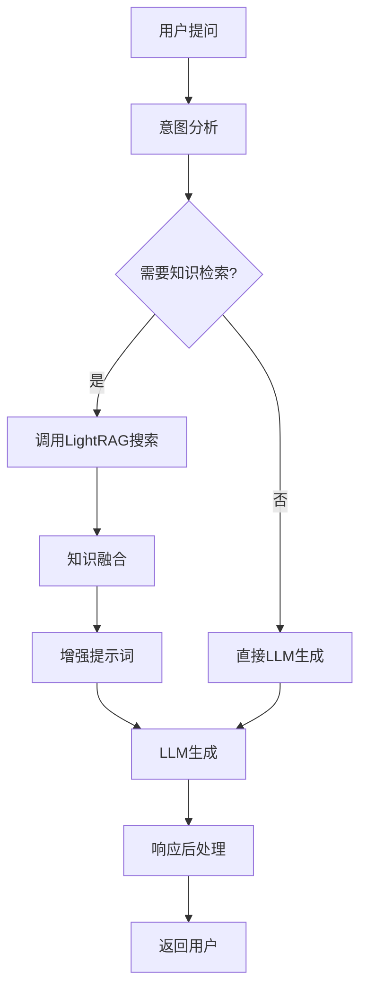

# 聊天服务 (Chat Service)

## 概述

聊天服务是STP平台的智能对话组件，提供实时WebSocket连接、多轮对话管理、上下文保持和知识检索集成功能。该服务支持与LightRAG知识图谱的深度集成，实现智能问答和文档检索。

## 服务信息

- **服务名称**: chat
- **默认端口**: 8001
- **协议**: WebSocket + HTTP
- **数据库**: PostgreSQL
- **依赖服务**: LightRAG, LLM Service

## 核心功能

### 1. 实时对话
- WebSocket双向通信
- 流式响应输出
- 连接状态管理

### 2. 多轮对话管理
- 会话上下文保持
- 对话历史存储
- 智能上下文窗口管理

### 3. 知识增强问答
- 与LightRAG知识图谱集成
- 文档检索和引用
- 上下文相关性匹配

### 4. 对话引擎
- 多种对话模式支持
- 自定义提示词模板
- 响应质量优化

## 项目结构

```
src/modules/chat/
├── README.md               # 现有文档
├── README_DETAILED.md      # 本详细文档
├── main.py                 # 服务启动入口
├── chat_service.py         # 核心聊天服务
├── chat_manager.py         # 会话管理器
├── chat_engine.py          # 对话引擎
├── models.py               # 数据模型
├── config/
│   └── config.py           # 配置管理
├── models/
│   ├── chat_history.py     # 聊天历史模型
│   └── chat_message.py     # 消息模型
└── Dockerfile              # 容器化配置
```

## 核心组件

### 1. 聊天服务 (ChatService)

**文件**: `chat_service.py`

**主要功能**:
- WebSocket连接管理
- 消息路由和处理
- 会话状态维护

**关键方法**:
```python
class ChatService:
    async def handle_websocket(self, websocket: WebSocket, session_id: str)
    async def process_message(self, message: dict, session_id: str) -> dict
    async def get_chat_history(self, session_id: str, limit: int = 50) -> list
    async def clear_session(self, session_id: str) -> bool
```

### 2. 会话管理器 (ChatManager)

**文件**: `chat_manager.py`

**主要功能**:
- 会话生命周期管理
- 上下文窗口控制
- 对话历史优化

**关键方法**:
```python
class ChatManager:
    async def create_session(self, user_id: int, project_id: str) -> str
    async def get_session_context(self, session_id: str) -> dict
    async def update_session_context(self, session_id: str, message: dict)
    async def cleanup_expired_sessions(self)
```

### 3. 对话引擎 (ChatEngine)

**文件**: `chat_engine.py`

**主要功能**:
- LLM模型调用
- 知识检索集成
- 响应生成和优化

**关键方法**:
```python
class ChatEngine:
    async def generate_response(self, query: str, context: dict) -> str
    async def retrieve_knowledge(self, query: str, project_id: str) -> list
    async def format_response_with_sources(self, response: str, sources: list) -> dict
```

## 数据库设计

### 聊天会话表 (chat_sessions)

```sql
CREATE TABLE chat_sessions (
    id UUID PRIMARY KEY DEFAULT gen_random_uuid(),
    user_id INTEGER NOT NULL,
    project_id VARCHAR(255),
    session_name VARCHAR(255),
    context_data JSONB DEFAULT '{}',
    is_active BOOLEAN DEFAULT true,
    created_at TIMESTAMP DEFAULT CURRENT_TIMESTAMP,
    updated_at TIMESTAMP DEFAULT CURRENT_TIMESTAMP,
    expires_at TIMESTAMP DEFAULT (CURRENT_TIMESTAMP + INTERVAL '24 hours')
);
```

### 聊天消息表 (chat_messages)

```sql
CREATE TABLE chat_messages (
    id UUID PRIMARY KEY DEFAULT gen_random_uuid(),
    session_id UUID REFERENCES chat_sessions(id) ON DELETE CASCADE,
    message_type VARCHAR(20) NOT NULL, -- 'user', 'assistant', 'system'
    content TEXT NOT NULL,
    metadata JSONB DEFAULT '{}',
    sources JSONB DEFAULT '[]',
    created_at TIMESTAMP DEFAULT CURRENT_TIMESTAMP
);
```

### 索引优化

```sql
-- 会话查询优化
CREATE INDEX idx_chat_sessions_user_project ON chat_sessions(user_id, project_id);
CREATE INDEX idx_chat_sessions_active ON chat_sessions(is_active, expires_at);

-- 消息查询优化
CREATE INDEX idx_chat_messages_session_time ON chat_messages(session_id, created_at DESC);
CREATE INDEX idx_chat_messages_type ON chat_messages(message_type);
```

## WebSocket协议

### 连接建立

```javascript
// 客户端连接
const ws = new WebSocket('ws://localhost:8001/chat/ws/{session_id}?token={jwt_token}');
```

### 消息格式

**用户消息**:
```json
{
  "type": "user_message",
  "content": "请解释一下人工智能的发展历程",
  "project_id": "project123",
  "metadata": {
    "timestamp": "2024-01-01T10:00:00Z"
  }
}
```

**系统响应**:
```json
{
  "type": "assistant_message",
  "content": "人工智能的发展历程可以分为以下几个阶段...",
  "sources": [
    {
      "document_id": "doc_001",
      "title": "AI发展史",
      "relevance_score": 0.95
    }
  ],
  "metadata": {
    "model": "deepseek-chat",
    "processing_time": 1.2,
    "token_count": 156
  }
}
```

**流式输出**:
```json
{
  "type": "stream_chunk",
  "content": "人工智能",
  "is_complete": false,
  "chunk_id": 1
}
```

### 错误处理

```json
{
  "type": "error",
  "error_code": "KNOWLEDGE_RETRIEVAL_FAILED",
  "message": "知识检索服务暂时不可用",
  "retry_after": 5
}
```

## API端点

### HTTP接口

#### 会话管理

```bash
# 创建新会话
POST /chat/sessions
{
  "project_id": "project123",
  "session_name": "技术讨论"
}

# 获取会话列表
GET /chat/sessions?user_id=1&project_id=project123

# 获取会话详情
GET /chat/sessions/{session_id}

# 删除会话
DELETE /chat/sessions/{session_id}
```

#### 消息历史

```bash
# 获取聊天历史
GET /chat/sessions/{session_id}/messages?limit=50&offset=0

# 清空聊天历史
DELETE /chat/sessions/{session_id}/messages
```

#### 对话设置

```bash
# 更新会话配置
PUT /chat/sessions/{session_id}/config
{
  "model": "deepseek-chat",
  "temperature": 0.7,
  "max_tokens": 2000,
  "knowledge_retrieval": true
}
```

## 知识检索集成

### LightRAG集成流程



### 知识检索配置

```python
# 知识检索参数
KNOWLEDGE_RETRIEVAL_CONFIG = {
    "enabled": True,
    "max_documents": 5,
    "similarity_threshold": 0.7,
    "retrieval_modes": ["naive", "local", "global"],
    "rerank": True,
    "chunk_size": 1000
}
```

### 检索结果处理

```python
async def process_retrieved_knowledge(self, query: str, project_id: str) -> list:
    """处理知识检索结果"""
    # 调用LightRAG服务
    search_results = await self.lightrag_client.search(
        query=query,
        project_id=project_id,
        top_k=5,
        mode="hybrid"
    )
    
    # 结果过滤和排序
    filtered_results = [
        result for result in search_results 
        if result['relevance_score'] > 0.7
    ]
    
    return filtered_results[:3]  # 最多返回3个最相关的结果
```

## 对话模式

### 1. 普通对话模式

- 基础LLM对话能力
- 支持多轮上下文
- 无知识检索

### 2. 知识增强模式

- 集成文档检索
- 引用来源显示
- 基于知识图谱的回答

### 3. 专家模式

- 深度领域知识
- 复杂推理能力
- 多步骤问题解决

### 4. 创意模式

- 创意内容生成
- 开放性对话
- 想象力激发

## 配置参数

### 环境变量

```bash
# 服务配置
CHAT_SERVICE_PORT=8001
CHAT_SERVICE_HOST=0.0.0.0

# 数据库配置
CHAT_DB_HOST=localhost
CHAT_DB_PORT=5432
CHAT_DB_NAME=stpdb
CHAT_DB_USER=stpuser
CHAT_DB_PASSWORD=stppassword

# LLM服务配置
LLM_SERVICE_URL=http://localhost:8888
DEFAULT_LLM_MODEL=deepseek-chat
LLM_TIMEOUT=30

# LightRAG服务配置
LIGHTRAG_SERVICE_URL=http://localhost:8006
KNOWLEDGE_RETRIEVAL_ENABLED=true

# WebSocket配置
WS_PING_INTERVAL=30
WS_PING_TIMEOUT=10
WS_MAX_CONNECTIONS=1000
```

### 对话配置

```python
# config/config.py
class ChatConfig:
    # 对话参数
    DEFAULT_TEMPERATURE = 0.7
    DEFAULT_MAX_TOKENS = 2000
    DEFAULT_TOP_P = 0.9
    
    # 上下文管理
    MAX_CONTEXT_LENGTH = 8000
    CONTEXT_WINDOW_OVERLAP = 200
    MAX_HISTORY_MESSAGES = 20
    
    # 会话管理
    SESSION_TIMEOUT_HOURS = 24
    MAX_SESSIONS_PER_USER = 10
    CLEANUP_INTERVAL_MINUTES = 60
```

## 性能优化

### 1. 连接管理
- WebSocket连接池
- 心跳检测机制
- 优雅断开连接

### 2. 缓存策略
- 会话上下文缓存
- 知识检索结果缓存
- LLM响应缓存

### 3. 并发控制
- 消息队列处理
- 限流和背压控制
- 异步I/O优化

### 4. 内存管理
- 上下文窗口滑动
- 会话超时清理
- 大对象垃圾回收

## 监控和指标

### 关键指标

1. **服务指标**
   - WebSocket连接数
   - 消息处理速度
   - 响应延迟

2. **业务指标**
   - 会话活跃度
   - 用户满意度
   - 知识检索命中率

3. **系统指标**
   - 内存使用率
   - CPU利用率
   - 数据库连接数

### 日志记录

```python
# 关键事件日志
logger.info(f"会话创建: session_id={session_id}, user_id={user_id}")
logger.info(f"消息处理: 耗时={processing_time}ms, tokens={token_count}")
logger.warning(f"知识检索失败: query={query}, error={error}")
logger.error(f"WebSocket连接断开: session_id={session_id}, reason={reason}")
```

## 部署和运维

### 1. 启动服务

```bash
# 开发环境
python -m src.modules.chat.main

# 生产环境
uvicorn src.modules.chat.main:app --host 0.0.0.0 --port 8001 --workers 4
```

### 2. Docker部署

```dockerfile
FROM python:3.9-slim
WORKDIR /app
COPY requirements.txt .
RUN pip install -r requirements.txt
COPY . .
EXPOSE 8001
CMD ["uvicorn", "main:app", "--host", "0.0.0.0", "--port", "8001"]
```

### 3. 健康检查

```bash
# HTTP健康检查
curl http://localhost:8001/health

# WebSocket连接测试
wscat -c ws://localhost:8001/chat/ws/test-session
```

### 4. 数据库维护

```sql
-- 清理过期会话
DELETE FROM chat_sessions WHERE expires_at < NOW();

-- 统计活跃会话
SELECT COUNT(*) FROM chat_sessions WHERE is_active = true;

-- 分析消息类型分布
SELECT message_type, COUNT(*) 
FROM chat_messages 
WHERE created_at > NOW() - INTERVAL '24 hours'
GROUP BY message_type;
```

## 故障排除

### 常见问题

1. **WebSocket连接失败**
   - 检查防火墙和代理设置
   - 验证JWT令牌有效性
   - 确认服务端口可访问

2. **知识检索不准确**
   - 检查LightRAG服务状态
   - 调整相似度阈值
   - 优化检索关键词

3. **响应速度慢**
   - 检查LLM服务性能
   - 优化上下文长度
   - 启用缓存机制

4. **内存占用过高**
   - 检查会话清理机制
   - 监控连接数量
   - 调整上下文窗口大小

### 调试工具

```bash
# 查看活跃连接
curl http://localhost:8001/debug/connections

# 检查会话状态
curl http://localhost:8001/debug/sessions

# 监控服务指标
curl http://localhost:8001/metrics
```

## 安全考虑

### 1. 认证授权
- JWT令牌验证
- 会话权限检查
- 跨源请求保护

### 2. 数据保护
- 敏感信息过滤
- 对话内容加密
- 审计日志记录

### 3. 防护机制
- 消息频率限制
- 恶意内容检测
- DDoS攻击防护

## 扩展功能

### 1. 多模态支持
- 图片理解和描述
- 文档上传和分析
- 语音输入输出

### 2. 协作功能
- 多用户会话
- 会话分享和导出
- 团队知识库集成

### 3. 个性化
- 用户偏好学习
- 个性化推荐
- 自定义对话风格