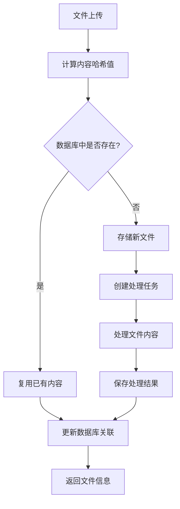
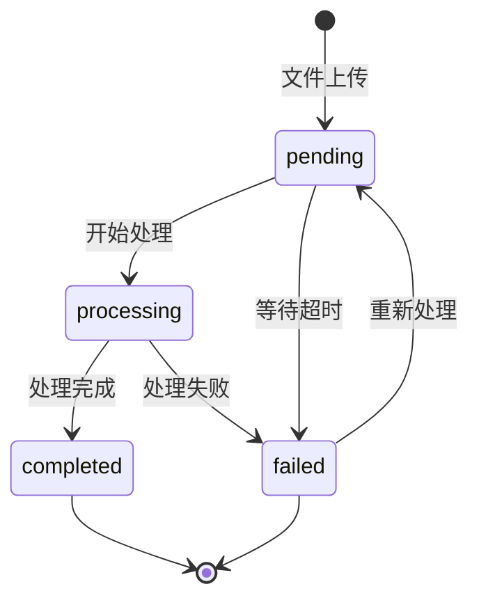
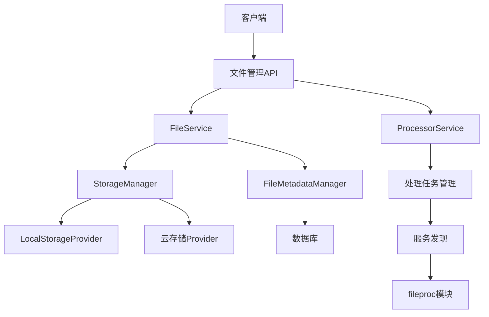
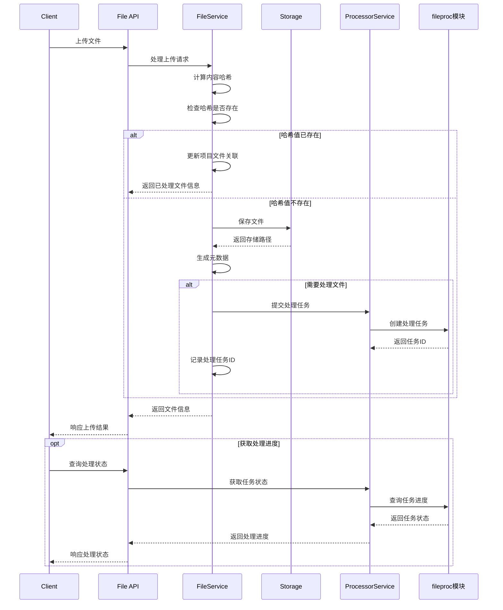
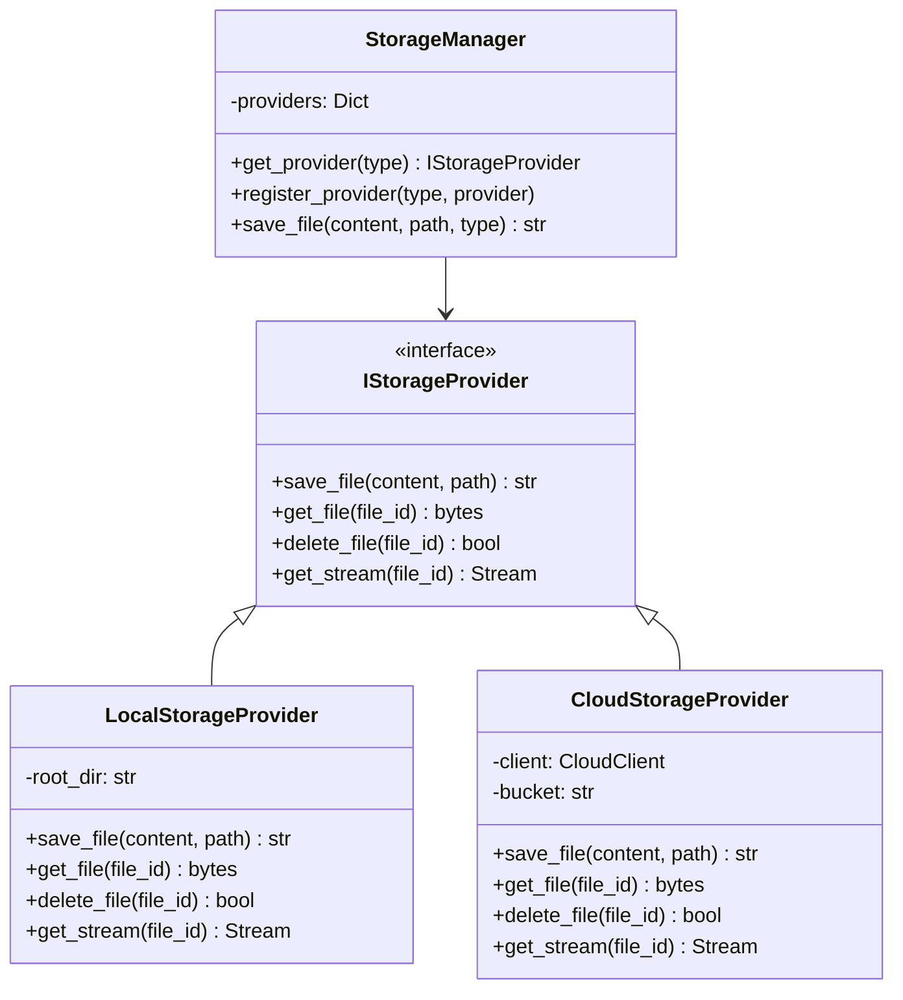
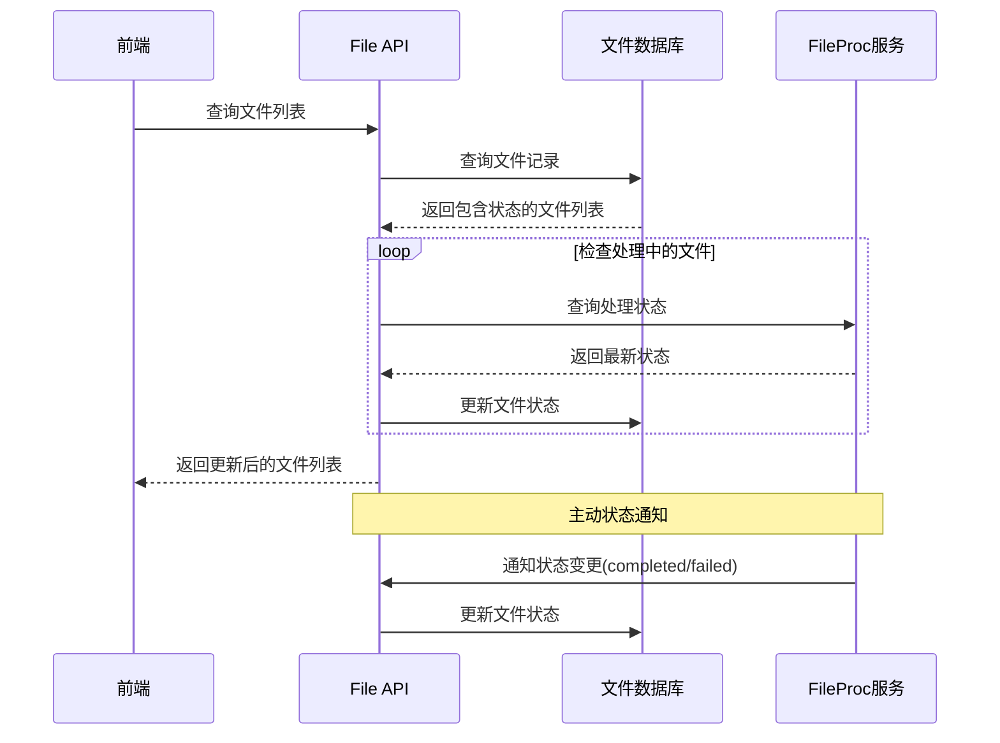
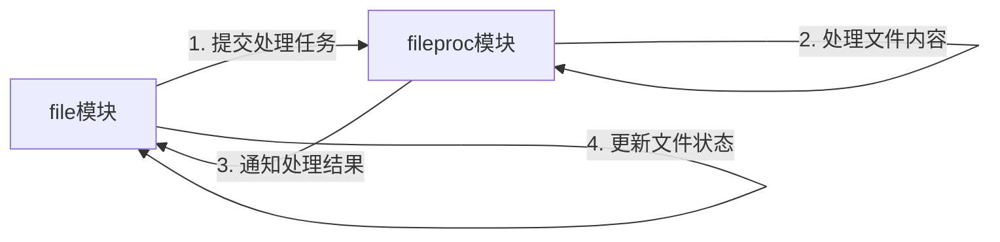
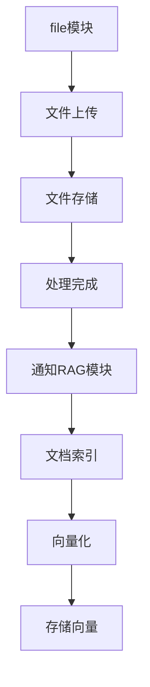

# File 文件管理模块

## 概述

`file` 模块是Lumidoc平台的文件管理服务，主要负责文件的上传、存储、元数据管理和流式读取。该模块专注于文件的基础管理功能，与fileproc模块协作处理文件内容分析和转换工作。

## 基于内容哈希的文件处理系统

`file` 模块实现了基于内容哈希的高效文件处理系统，具有以下核心特性：

### 1. 内容哈希机制
- 使用完整的SHA-256算法计算文件内容哈希，确保唯一性
- 哈希值作为文件的内容标识符，而非传统的文件名或路径
- 相同内容的文件生成相同的哈希值，实现内容级别的唯一标识

### 2. 文件去重存储
- 不同项目上传相同内容的文件时，物理存储只保留一份
- 使用哈希值作为文件名保存在项目目录中
- 数据库中维护项目与文件内容的多对多关系

### 3. 处理结果复用
- 当识别到已处理过的文件内容时，直接复用已有处理结果
- 避免重复处理相同内容，大幅提高系统效率
- 处理结果以哈希值命名保存在统一的content目录

### 4. 文件处理流程


### 5. 数据库结构
- `project_files` 表：记录项目与文件的关联
  - `id`: 文件记录ID
  - `project_id`: 项目ID
  - `file_hash`: 文件内容哈希值
  - `name`: 原始文件名
  - `path`: 存储路径
  - `status`: 处理状态
  - `processing_task_id`: 关联的处理任务ID

- `file_contents` 表：记录文件内容信息
  - `file_hash`: 文件内容哈希值（主键）
  - `markdown_content`: 处理后的内容
  - `metadata`: 文件元数据
  - `file_type`: 文件类型
  - `page_count`: 页数统计

### 6. 优势与特性
- **存储效率**：相同内容只存储一次，节约存储空间
- **处理效率**：避免重复处理，减少计算资源消耗
- **数据一致性**：相同内容产生相同的处理结果
- **横向扩展**：支持分布式部署和多实例处理
- **容错性**：文件处理失败后可重新提交处理

## 文件状态管理机制

### 1. 文件状态流转

文件在系统中有明确的状态流转过程，确保前端可以准确显示文件的处理阶段：



### 2. 状态同步机制

- **任务ID映射**：使用`processing_task_id`字段关联fileproc中的任务
- **定期状态轮询**：定期从fileproc服务获取最新处理状态
- **状态更新回调**：fileproc服务处理状态变化时主动通知
- **缓存机制优化**：状态查询接口使用cache-busting参数避免缓存问题
- **状态恢复**：服务重启后能恢复处理中文件的状态追踪

### 3. 状态更新优化

最新实现中的状态更新优化：
- 查询状态时跳过Redis缓存，确保获取最新状态
- 使用多种查询机制确保文件状态不会"卡住"
- 即使任务ID映射丢失也能根据文件哈希找到对应文件
- 文件状态变更时及时更新数据库记录
- 完善的错误处理和日志记录，方便故障排查

## 模块架构



## 文件上传流程



## 主要职责

1. **文件上传与存储**：接收客户端上传的文件，保存到本地或云存储系统
2. **文件元数据管理**：维护文件的基本信息（名称、大小、类型等）
3. **文件内容流式访问**：提供文件内容的流式读取接口
4. **存储接口抽象**：提供统一的存储接口，支持本地存储和云存储
5. **文件组织**：基于项目和用户管理文件的组织结构
6. **处理任务提交**：将文件处理任务提交给fileproc模块
7. **状态跟踪管理**：跟踪文件处理状态，确保前端展示正确的处理进度

## 存储架构



## 主要组件

### 1. 文件服务类

该模块包含主要的文件服务类:

#### FileService（file_service.py）
- **职责**: 基础文件管理和元数据操作
- **功能**: 上传、下载和元数据维护
- **存储策略**: 支持本地和云存储

#### ProcessorService（file_processor_service.py）
- **职责**: 提交和跟踪文件处理任务
- **功能**: 处理任务提交、进度查询、状态更新
- **交互**: 通过服务发现调用fileproc模块
- **状态管理**: 定期轮询和回调接收文件处理状态

### 2. 存储管理

- **StorageProvider接口**: 统一的存储实现标准
- **本地存储实现**: 基于本地文件系统的存储
- **云存储实现**: 支持S3、OSS等云存储
- **存储策略**: 根据文件特性选择合适的存储方式

### 3. 元数据管理

- **文件元数据**: 包括基本属性和扩展属性
- **索引结构**: 支持高效检索和过滤
- **版本控制**: 支持文件版本管理
- **关系映射**: 项目、用户和文件的关系管理

## API接口

### 文件管理API

```
POST /api/files/upload                      # 上传文件
GET /api/files/{file_id}                    # 获取文件信息
GET /api/files/download/{file_id}           # 下载文件
DELETE /api/files/{file_id}                 # 删除文件
GET /api/files/stream/{file_id}             # 流式获取文件内容
```

### 项目文件API

```
GET /api/projects/{project_id}/files        # 获取项目文件列表
POST /api/projects/{project_id}/files       # 上传文件到项目
GET /api/projects/{project_id}/files/stats  # 获取项目文件统计
```

### 处理任务API

```
POST /api/files/{file_id}/process           # 提交处理任务
GET /api/tasks/{task_id}                    # 获取任务状态
DELETE /api/tasks/{task_id}                 # 取消任务
```

### 文件状态API

```
GET /api/files/status/{file_id}             # 获取文件状态
POST /api/file/status/update                # 更新文件状态(内部API)
```

### 健康检查API

```
GET /healthz                                # 服务健康状态
GET /api/info                               # 服务信息
```

## 与fileproc模块的区别

| 特性 | file模块 | fileproc模块 |
|------|---------|-------------|
| **主要职责** | 文件管理和存储 | 文件内容处理和转换 |
| **处理方式** | 同步操作为主 | 异步队列处理为主 |
| **面向对象** | 直接面向客户端 | 主要面向内部系统 |
| **资源使用** | 轻量级IO操作 | 计算密集型处理 |
| **处理关注点** | 物理存储和元数据 | 内容处理和分析 |
| **状态通知** | 接收状态更新 | 主动通知状态更新 |

## 与fileproc模块的集成

### 状态通信机制



### 服务调用代码

```python
# 提交文件到fileproc服务处理
async def submit_to_fileproc(file_hash: str, file_path: str, metadata: Dict[str, Any]) -> str:
    """提交文件到fileproc服务处理，返回任务ID"""
    client = await ServiceClient.get_instance()
    
    # 调用fileproc服务提交处理任务
    response = await client.call_api(
        service_name="fileproc",
        path="api/tasks/enqueue",
        method="POST",
        json_data={
            "file_hash": file_hash,
            "file_path": file_path,
            "metadata": metadata
        },
        use_service_auth=True  # 使用服务间认证
    )
    
    if response and "task_id" in response:
        return response["task_id"]
    
    raise Exception(f"提交处理任务失败: {response}")
```

### 状态更新代码

```python
# 获取处理状态
async def get_processing_status(self, task_id: str) -> Dict[str, Any]:
    """获取文件处理状态"""
    try:
        # 添加缓存规避参数
        import random
        cache_bust = random.randint(10000, 99999)
        
        # 调用fileproc服务获取任务状态
        task_status = await call_service(
            "fileproc", 
            f"api/status/{task_id}", 
            method="GET",
            params={"_cb": cache_bust}
        )
        
        if task_status:
            status = task_status.get("status", "pending")
            
            # 如果状态为完成或失败，更新数据库
            if status in ["completed", "failed"]:
                # 查找关联的文件
                file_hash = task_status.get("file_hash")
                if file_hash:
                    await self.update_file_status(
                        file_hash=file_hash,
                        project_id=task_status.get("project_id", ""),
                        status=status
                    )
                    
            return task_status
            
    except Exception as e:
        logger.error(f"获取处理状态失败: {str(e)}")
        
    return {"status": "unknown", "progress": 0, "message": "无法获取状态"}
```

## 最近改进

- **状态查询缓存优化**：状态查询接口添加随机参数避免缓存问题
- **状态映射增强**：改进了任务ID与文件的映射关系维护
- **数据库同步机制**：确保文件状态变更及时写入数据库
- **错误恢复增强**：提高状态查询的容错能力
- **文件关联查询**：增加通过文件哈希和项目ID查找文件的备用方法
- **日志增强**：添加详细的状态跟踪日志，便于排查问题

## 使用示例

### 文件上传和基本操作

```python
from src.modules.file import FileService

# 初始化服务
file_service = FileService()

# 上传文件
file_info = await file_service.upload_file(
    file_content=file_data,
    filename="document.pdf",
    project_id="project123"
)

# 获取文件信息
file_info = await file_service.get_file_info(file_id="file123")
```

### 处理任务提交

```python
from src.modules.file import ProcessorService

# 初始化处理服务
processor = ProcessorService()

# 提交处理任务
task_id = await processor.submit_task(
    file_id="file123",
    process_type="text_extraction"
)

# 获取任务进度
progress = await processor.get_task_progress(task_id)
```

## 配置参数

在`.env`文件中设置:

```
# 文件服务配置
FILE_SERVICE_PORT=8004
STORAGE_DIR=./storage
MAX_FILE_SIZE=10485760
DEFAULT_STORAGE_TYPE=local

# 服务认证
SERVICE_AUTH_TOKEN=service-token-for-internal-use

# Redis配置（用于服务发现）
REDIS_HOST=localhost
REDIS_PORT=6379
REDIS_PASSWORD=123456789
```

## 与其他模块集成

### 与fileproc模块集成



file模块与fileproc模块协作流程:
- file模块负责文件的物理存储和元数据管理
- file模块通过服务发现将处理任务提交给fileproc模块
- fileproc模块获取文件、执行处理任务
- 处理完成后，fileproc通过API通知file模块更新状态
- 客户端统一通过file模块API查询文件状态和处理进度

### 与RAG模块集成



文件服务为RAG提供文档源:
- 文档上传后可自动索引
- 支持大型文档的流式处理
- 提供原始文档和处理后内容访问

## 异常处理策略

### 存储异常

- **文件不存在**: 返回404错误和明确提示
- **存储空间不足**: 监控存储空间，提前扩容
- **权限问题**: 检查存储目录权限
- **存储介质故障**: 实现数据备份和恢复机制

### 处理任务异常

- **处理超时**: 设置合理的超时时间，自动取消长时间未响应的任务
- **处理失败**: 记录失败原因，提供重试机制
- **依赖服务不可用**: 优雅降级，保障基本功能可用
- **任务状态不同步**: 实现定期状态同步机制

## 文件安全

- **上传验证**: 检查文件类型、大小和内容
- **访问控制**: 基于用户和项目权限控制文件访问
- **敏感内容检测**: 支持配置敏感内容扫描
- **存储加密**: 支持文件内容加密存储
- **下载限制**: 防止批量下载和滥用 