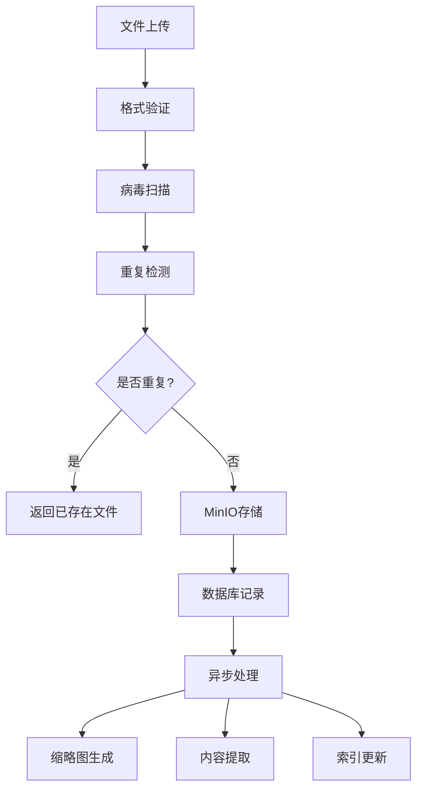

# 文件服务 (File Service)

## 概述

文件服务是Lumidoc平台的核心文件管理组件，负责文件上传、下载、存储、预览和元数据管理。该服务支持多种文件格式，提供安全的文件存储和高效的文件访问能力。

## 服务信息

- **服务名称**: file
- **默认端口**: 8004
- **数据库**: PostgreSQL
- **存储后端**: MinIO (S3兼容)
- **支持格式**: PDF, DOC/DOCX, TXT, PPT/PPTX, XLS/XLSX, 图片等

## 核心功能

### 1. 文件上传管理
- 多文件批量上传
- 文件格式验证
- 大文件分块上传
- 上传进度跟踪

### 2. 文件存储
- MinIO对象存储集成
- 文件去重机制
- 版本控制支持
- 安全访问控制

### 3. 文件预览
- 在线文档预览
- 图片缩略图生成
- 文件元数据提取
- 格式转换支持

### 4. 项目文件管理
- 项目级文件隔离
- 文件分类和标签
- 批量操作支持
- 文件检索功能

## 项目结构

```
src/modules/file/
├── README.md               # 现有简要文档
├── README_DETAILED.md      # 本详细文档
├── main.py                 # 服务启动入口
├── file_processor_service.py # 核心文件处理服务
├── tasks.py                # 异步任务处理
├── diagnose.py             # 服务诊断工具
├── config/
│   ├── config.py           # 服务配置
│   └── database.py         # 数据库配置
├── routes/
│   └── file_routes.py      # API路由定义
├── models/
│   └── schema.py           # 数据模型定义
├── database/
│   ├── ensure_tables.py    # 表结构创建
│   ├── check_schema.py     # 模式验证
│   └── apply_migrations.py # 数据库迁移
├── migrations/
│   ├── create_file_contents_table.sql
│   ├── add_file_hash_column.sql
│   └── alter_column_lengths.sql
├── utils/
│   └── file_upload_utils.py # 文件上传工具
└── Dockerfile              # 容器化配置
```

## 数据库设计

### 文件内容表 (file_contents)

```sql
CREATE TABLE file_contents (
    id SERIAL PRIMARY KEY,
    project_id VARCHAR(255) NOT NULL,
    file_id VARCHAR(255) UNIQUE NOT NULL,
    original_filename VARCHAR(500) NOT NULL,
    file_path TEXT NOT NULL,
    file_size BIGINT NOT NULL,
    file_hash VARCHAR(64),
    content_type VARCHAR(100),
    upload_status VARCHAR(20) DEFAULT 'pending',
    processed_content TEXT,
    metadata JSONB DEFAULT '{}',
    created_at TIMESTAMP DEFAULT CURRENT_TIMESTAMP,
    updated_at TIMESTAMP DEFAULT CURRENT_TIMESTAMP,
    uploaded_by INTEGER,
    
    -- 索引优化
    INDEX idx_file_contents_project_id (project_id),
    INDEX idx_file_contents_hash (file_hash),
    INDEX idx_file_contents_status (upload_status),
    INDEX idx_file_contents_filename (original_filename)
);
```

### 文件版本表 (file_versions)

```sql
CREATE TABLE file_versions (
    id SERIAL PRIMARY KEY,
    file_id VARCHAR(255) REFERENCES file_contents(file_id),
    version_number INTEGER NOT NULL,
    file_path TEXT NOT NULL,
    file_size BIGINT NOT NULL,
    version_hash VARCHAR(64),
    created_at TIMESTAMP DEFAULT CURRENT_TIMESTAMP,
    created_by INTEGER,
    
    UNIQUE(file_id, version_number)
);
```

## API接口

### 文件上传

```bash
# 单文件上传
POST /files/upload
Content-Type: multipart/form-data

# 请求参数
- file: 上传的文件
- project_id: 项目ID
- category: 文件分类 (可选)
- description: 文件描述 (可选)

# 响应示例
{
  "success": true,
  "file_id": "file_abc123",
  "original_filename": "document.pdf",
  "file_size": 1024000,
  "content_type": "application/pdf",
  "upload_status": "completed"
}
```

### 批量文件上传

```bash
# 多文件上传
POST /files/batch-upload
Content-Type: multipart/form-data

# 请求参数
- files[]: 多个文件
- project_id: 项目ID
- descriptions[]: 对应文件描述 (可选)

# 响应示例
{
  "success": true,
  "uploaded_files": [
    {
      "file_id": "file_abc123",
      "original_filename": "doc1.pdf",
      "status": "completed"
    },
    {
      "file_id": "file_def456", 
      "original_filename": "doc2.docx",
      "status": "completed"
    }
  ],
  "failed_files": []
}
```

### 文件下载

```bash
# 文件下载
GET /files/download/{file_id}

# 带权限验证的下载
GET /files/download/{file_id}?token={access_token}

# 缩略图下载
GET /files/thumbnail/{file_id}?size=medium
```

### 文件管理

```bash
# 获取项目文件列表
GET /files/project/{project_id}?page=1&limit=20&category=document

# 获取文件详情
GET /files/{file_id}/info

# 删除文件
DELETE /files/{file_id}

# 批量删除
DELETE /files/batch
{
  "file_ids": ["file_abc123", "file_def456"]
}

# 更新文件信息
PUT /files/{file_id}
{
  "filename": "new_name.pdf",
  "description": "Updated description",
  "category": "report"
}
```

### 文件预览

```bash
# 获取预览URL
GET /files/{file_id}/preview

# 文件内容搜索
GET /files/search?q=keyword&project_id=123&content_type=pdf
```

## 存储集成

### MinIO配置

```python
# MinIO存储配置
MINIO_CONFIG = {
    "endpoint": "localhost:9000",
    "access_key": "minioadmin",
    "secret_key": "minioadmin", 
    "secure": False,
    "bucket_name": "lumidoc-files"
}

# 存储路径结构
STORAGE_PATHS = {
    "upload": "upload/",      # 原始上传文件
    "content": "content/",    # 处理后内容
    "thumbnails": "thumbs/",  # 缩略图
    "temp": "temp/"          # 临时文件
}
```

### 文件存储流程



### 去重机制

```python
async def check_file_duplicate(self, file_hash: str, project_id: str) -> Optional[dict]:
    """检查文件是否重复"""
    existing_file = await self.db.fetchrow("""
        SELECT file_id, original_filename, file_path 
        FROM file_contents 
        WHERE file_hash = $1 AND project_id = $2
    """, file_hash, project_id)
    
    return existing_file
```

## 文件处理

### 支持的文件格式

| 格式类别 | 支持格式 | 处理能力 |
|----------|----------|----------|
| 文档 | PDF, DOC, DOCX, RTF | 文本提取, 预览生成 |
| 表格 | XLS, XLSX, CSV | 数据解析, 预览生成 |
| 演示 | PPT, PPTX | 幻灯片预览, 文本提取 |
| 图片 | JPG, PNG, GIF, WEBP | 缩略图, 格式转换 |
| 文本 | TXT, MD, JSON, XML | 语法高亮, 预览 |
| 代码 | PY, JS, HTML, CSS | 语法解析, 高亮显示 |

### 文件处理管道

```python
class FileProcessor:
    async def process_file(self, file_id: str) -> dict:
        """处理上传的文件"""
        try:
            # 1. 获取文件信息
            file_info = await self.get_file_info(file_id)
            
            # 2. 内容提取
            content = await self.extract_content(file_info)
            
            # 3. 生成缩略图
            if self.is_image_file(file_info):
                await self.generate_thumbnails(file_info)
            
            # 4. 更新处理状态
            await self.update_processing_status(file_id, "completed")
            
            return {"success": True, "processed_content": content}
            
        except Exception as e:
            await self.update_processing_status(file_id, "failed")
            raise e
```

### 缩略图生成

```python
# 支持的缩略图尺寸
THUMBNAIL_SIZES = {
    "small": (150, 150),
    "medium": (300, 300), 
    "large": (600, 600)
}

async def generate_thumbnail(self, file_path: str, size: str = "medium") -> str:
    """生成文件缩略图"""
    from PIL import Image
    
    with Image.open(file_path) as image:
        # 保持宽高比缩放
        image.thumbnail(THUMBNAIL_SIZES[size], Image.Resampling.LANCZOS)
        
        # 保存到MinIO
        thumbnail_path = f"thumbs/{file_id}_{size}.jpg"
        await self.minio_client.put_object(thumbnail_path, image_bytes)
        
        return thumbnail_path
```

## 安全机制

### 1. 文件验证

```python
# 文件类型白名单
ALLOWED_EXTENSIONS = {
    'document': ['.pdf', '.doc', '.docx', '.txt', '.rtf'],
    'spreadsheet': ['.xls', '.xlsx', '.csv'],
    'presentation': ['.ppt', '.pptx'],
    'image': ['.jpg', '.jpeg', '.png', '.gif', '.webp'],
    'archive': ['.zip', '.rar', '.7z']
}

# 文件大小限制
MAX_FILE_SIZE = {
    'document': 50 * 1024 * 1024,    # 50MB
    'image': 10 * 1024 * 1024,       # 10MB
    'archive': 100 * 1024 * 1024     # 100MB
}
```

### 2. 访问控制

```python
async def check_file_access(self, file_id: str, user_id: int) -> bool:
    """检查用户文件访问权限"""
    file_info = await self.get_file_info(file_id)
    
    # 检查项目权限
    has_project_access = await self.project_service.check_user_access(
        file_info['project_id'], user_id
    )
    
    return has_project_access
```

### 3. 病毒扫描

```python
async def scan_file_for_virus(self, file_path: str) -> bool:
    """病毒扫描 (集成ClamAV)"""
    try:
        import pyclamd
        cd = pyclamd.ClamdAgnostic()
        
        scan_result = cd.scan_file(file_path)
        return scan_result is None  # None表示无病毒
        
    except Exception:
        # 扫描失败时的处理策略
        return True  # 允许上传但记录日志
```

## 性能优化

### 1. 异步处理

```python
# 异步任务队列
import asyncio
from concurrent.futures import ThreadPoolExecutor

class FileTaskQueue:
    def __init__(self):
        self.executor = ThreadPoolExecutor(max_workers=4)
        self.queue = asyncio.Queue()
    
    async def add_processing_task(self, file_id: str):
        """添加文件处理任务"""
        await self.queue.put({
            'type': 'process_file',
            'file_id': file_id,
            'timestamp': time.time()
        })
    
    async def process_tasks(self):
        """处理任务队列"""
        while True:
            task = await self.queue.get()
            asyncio.create_task(self.execute_task(task))
```

### 2. 缓存策略

```python
# Redis缓存配置
CACHE_CONFIG = {
    "file_info_ttl": 3600,      # 文件信息缓存1小时
    "thumbnail_ttl": 86400,     # 缩略图缓存24小时
    "preview_ttl": 1800         # 预览内容缓存30分钟
}

async def get_cached_file_info(self, file_id: str) -> Optional[dict]:
    """获取缓存的文件信息"""
    cache_key = f"file_info:{file_id}"
    cached_data = await self.redis.get(cache_key)
    
    if cached_data:
        return json.loads(cached_data)
    return None
```

### 3. 分块上传

```python
class ChunkedUploadHandler:
    async def handle_chunk_upload(self, chunk_data: bytes, chunk_index: int, 
                                 total_chunks: int, upload_id: str):
        """处理分块上传"""
        chunk_path = f"temp/{upload_id}/chunk_{chunk_index}"
        
        # 存储分块
        await self.minio_client.put_object(chunk_path, chunk_data)
        
        # 检查是否所有分块完成
        if await self.all_chunks_uploaded(upload_id, total_chunks):
            await self.merge_chunks(upload_id, total_chunks)
```

## 监控和日志

### 关键指标

1. **上传指标**
   - 上传成功率
   - 平均上传速度
   - 文件处理时间

2. **存储指标**
   - 存储空间使用率
   - 去重效果统计
   - 访问频率分析

3. **性能指标**
   - API响应时间
   - 并发处理能力
   - 缓存命中率

### 日志示例

```python
# 文件上传日志
logger.info(f"文件上传开始: file_id={file_id}, size={file_size}, user={user_id}")
logger.info(f"文件处理完成: file_id={file_id}, duration={duration}ms")
logger.warning(f"文件格式不支持: filename={filename}, content_type={content_type}")
logger.error(f"文件上传失败: file_id={file_id}, error={error}")
```

## 部署和运维

### 1. 服务启动

```bash
# 开发环境
python -m src.modules.file.main

# 生产环境
uvicorn src.modules.file.main:app --host 0.0.0.0 --port 8004 --workers 2
```

### 2. 数据库迁移

```bash
# 应用数据库迁移
python src/modules/file/database/apply_migrations.py

# 检查表结构
python src/modules/file/database/check_schema.py

# 确保表存在
python src/modules/file/database/ensure_tables.py
```

### 3. MinIO设置

```bash
# 创建存储桶
mc mb minio/lumidoc-files

# 设置访问策略
mc policy set public minio/lumidoc-files/public/

# 查看存储统计
mc admin info minio
```

## 故障排除

### 常见问题

1. **文件上传失败**
   - 检查文件大小限制
   - 验证文件格式支持
   - 确认MinIO连接状态

2. **预览生成失败**
   - 检查依赖库安装
   - 验证文件完整性
   - 查看处理队列状态

3. **存储空间不足**
   - 清理临时文件
   - 删除重复文件
   - 扩展存储容量

### 调试工具

```bash
# 检查服务健康状态
curl http://localhost:8004/health

# 诊断文件服务
python src/modules/file/diagnose.py

# 查看处理队列状态
curl http://localhost:8004/debug/queue-status
```

## 扩展功能

### 1. 文件协作
- 多用户同时编辑
- 版本控制和合并
- 评论和批注功能

### 2. 高级搜索
- 全文搜索支持
- 文件内容索引
- 智能分类推荐

### 3. 批量处理
- 批量格式转换
- 自动化处理流程
- 定时任务支持