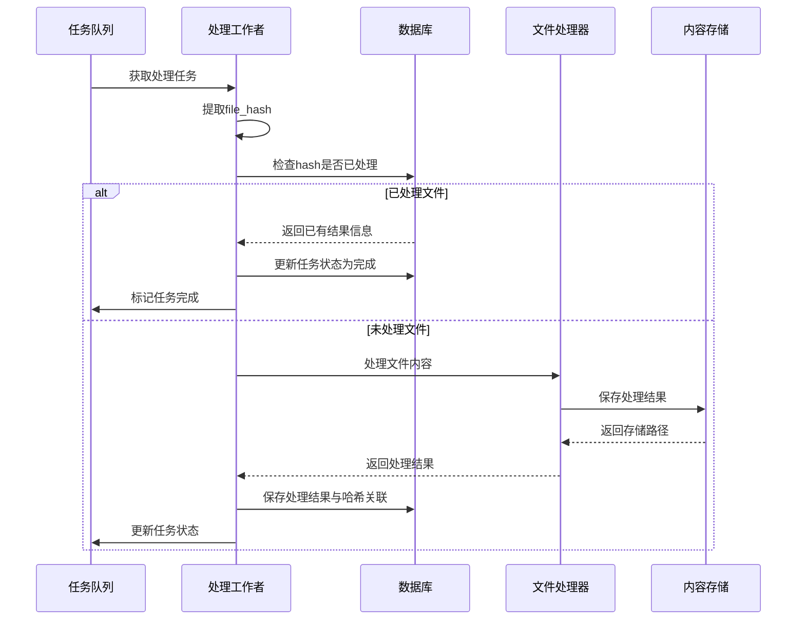
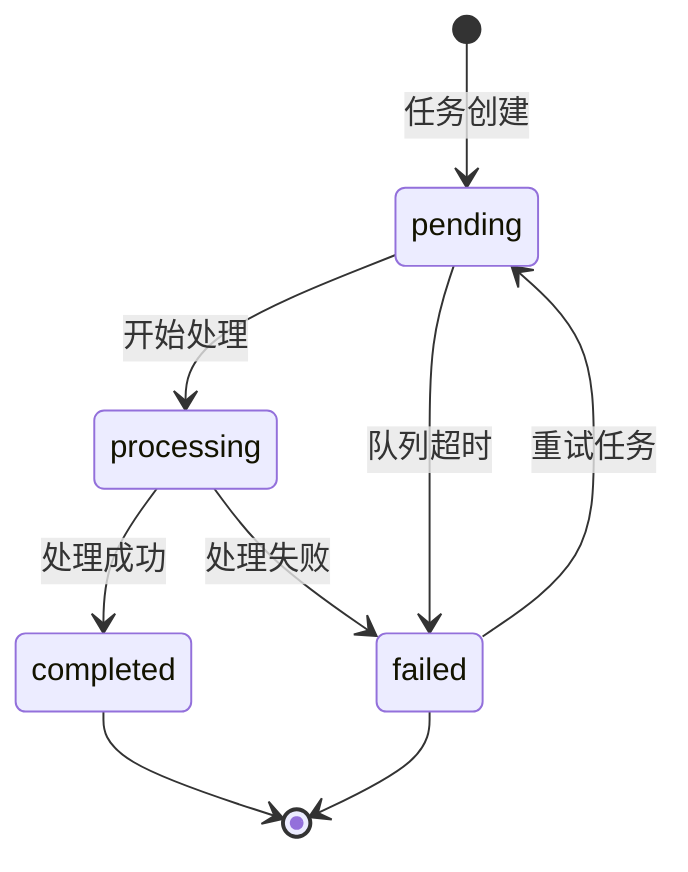
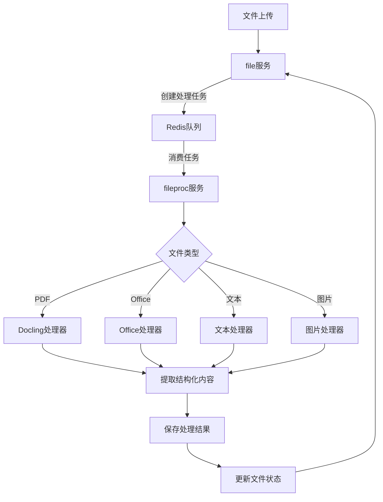
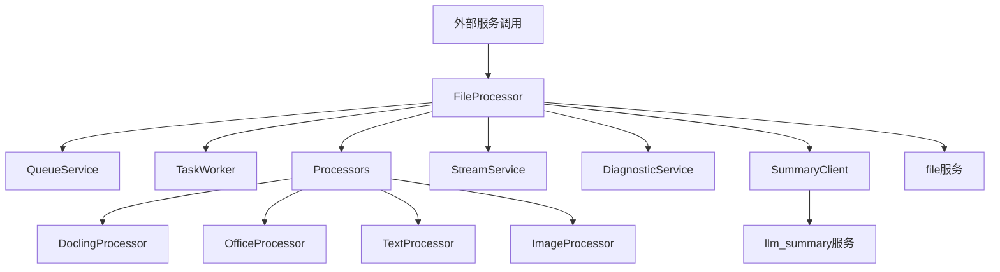

# FileProc 文件处理模块

## 概述

`fileproc`模块是STP平台的文件处理服务，专注于文件的异步处理、转换和内容分析。该模块基于Redis消息队列实现分布式任务处理，支持多实例部署和横向扩展，不负责文件的基础存储和元数据管理。

## 基于内容哈希的文件处理复用机制

`fileproc`模块实现了基于内容哈希的高效文件处理复用机制，有效避免重复处理相同内容的文件，显著提升系统处理效率和资源利用率。

### 1. 内容复用原理

- 使用SHA-256哈希值作为文件内容的唯一标识符
- 处理结果与内容哈希建立映射关系，而非与具体文件关联
- 当收到处理请求时，首先检查该哈希值是否已有处理结果
- 如有已处理结果，直接返回，不再重复处理
- 如无处理结果，执行完整处理流程并存储结果

### 2. 复用实现机制



### 3. 复用状态管理

- 数据库中的`file_contents`表存储哈希值与处理结果的映射关系
- 任务处理前检查此表确定是否可复用
- 处理结果包含多种元数据，如页数、摘要等
- 任务状态追踪仍保持独立，即使内容复用也有独立任务记录

### 4. 优势与效益

- **计算资源节约**：避免重复处理相同文件内容，大幅减少计算资源消耗
- **响应时间提升**：对于已处理内容，响应时间从分钟级缩短到秒级
- **跨项目共享**：不同项目上传相同内容的文件，可共享处理结果
- **存储空间优化**：处理结果只存储一份，避免冗余
- **处理一致性**：相同内容始终产生一致的处理结果，提高系统可靠性

### 5. 具体实现

工作流程：
1. 接收处理任务，提取文件哈希值
2. 查询数据库中是否存在该哈希值的处理记录
3. 如存在，直接更新任务状态为完成，关联到已有结果
4. 如不存在，执行完整处理流程，保存结果，更新数据库

关键代码：

```python
async def process_file(self, task_data: Dict[str, Any]) -> Dict[str, Any]:
    # 提取文件信息
    file_hash = task_data.get("payload", {}).get("file_hash")
    
    # 检查是否已处理
    content_exists = await self._check_content_exists(file_hash)
    
    if content_exists:
        # 复用已有结果
        logger.info(f"文件已处理，复用结果: hash={file_hash}")
        return {
            "success": True,
            "message": "复用已有处理结果",
            "file_hash": file_hash,
            "reused": True
        }
    
    # 执行文件处理...
    # 保存处理结果...
    
    return {
        "success": True,
        "message": "文件处理完成",
        "file_hash": file_hash,
        "reused": False
    }
```

## 状态更新机制

### 1. 任务状态流转

fileproc模块实现了完整的任务状态流转机制，确保文件处理过程中的状态变化能准确、及时地传递到依赖服务：



### 2. 状态同步机制

- **实时状态通知**：任务状态变更时立即通知file服务
- **定期状态轮询**：file服务定期从fileproc获取任务状态更新
- **状态缓存规避**：状态查询接口使用cache-busting参数避免缓存
- **失败重试机制**：状态更新失败时实施指数退避重试
- **双向状态验证**：关键状态变更时执行双向确认

### 3. 状态更新优化

最新实现中的状态更新优化：
- 启动文件处理时立即更新为"processing"状态
- 文件处理各阶段更新进度百分比
- 处理完成后主动调用file服务更新文件状态
- 实现状态更新失败的检测和恢复机制
- 记录详细的状态更新日志，便于故障排查

## 处理流程



## 主要职责

1. **异步文件处理**：通过消息队列处理长时间运行的文件任务
2. **文件格式转换**：处理各种文件格式，提取文本和结构化内容
3. **文件内容分析**：分析文件内容，提取关键信息
4. **分布式任务处理**：支持多实例部署的任务处理系统
5. **处理状态跟踪**：提供任务状态和进度的实时跟踪
6. **文件流式处理**：处理大型文件内容的流式读取和处理

## 架构设计

### 核心组件



1. **文件处理队列 (queue_service.py)**
   - 基于Redis实现的异步消息队列
   - 支持任务发布、订阅和状态跟踪
   - 提供任务优先级和超时处理
   - 适用于分布式环境的多实例部署

2. **文件处理器 (file_processor.py)**
   - 处理各类文件的核心组件
   - 支持多种文件格式（文本、Office文档、PDF）
   - 实现完全异步IO处理
   - 使用服务发现机制与其他服务交互

3. **任务工作者 (worker.py)**
   - 消费队列中的文件处理任务
   - 管理处理生命周期和资源分配
   - 提供处理状态实时更新
   - 实现错误处理和重试机制

4. **文件流处理服务 (file_processor_stream_service.py)**
   - 专注于文件内容流式处理
   - 提供文件内容分块读取
   - 支持流式处理大型文件

5. **服务诊断工具 (file_service_diagnostics.py)**
   - 提供文件服务健康检查
   - 诊断服务和配置问题
   - 提供问题修复建议

6. **摘要客户端 (summary_client.py)**
   - 与LLM摘要服务集成
   - 提供文档摘要生成功能
   - 管理摘要请求和响应

7. **Docling处理器 (docling_processor.py)**
   - 使用docling库处理PDF文件
   - 提取文档结构和内容
   - 支持OCR识别增强
   - 实时更新处理状态

### 微服务特性

- **服务注册与发现**: 通过Redis实现服务注册和发现
- **健康检查**: 提供标准化的健康检查端点(/healthz)
- **优雅降级**: 在依赖服务不可用时支持基本功能
- **可观测性**: 详细的日志和监控指标
- **无状态设计**: 支持容器化和水平扩展
- **资源限制适应**: 支持在有限资源环境中运行

## 与file模块的区别

| 特性 | fileproc模块 | file模块 |
|------|-------------|---------|
| **主要职责** | 文件内容处理和转换 | 文件管理和存储 |
| **处理方式** | 异步队列处理为主 | 同步操作为主 |
| **面向对象** | 主要面向内部系统 | 直接面向客户端 |
| **资源使用** | 计算密集型处理 | 轻量级IO操作 |
| **处理关注点** | 内容处理和分析 | 物理存储和元数据 |
| **状态通知** | 主动通知状态更新 | 接收状态更新 |

## API接口

### 任务管理API

```
POST /api/tasks/enqueue                   # 提交文件处理任务
GET /api/status/{task_id}                 # 获取任务状态
GET /api/tasks/result/{task_id}           # 获取处理结果
DELETE /api/tasks/{task_id}               # 取消任务
```

### 健康检查API

```
GET /healthz                              # 服务健康状态
GET /api/info                             # 服务信息
```

### 诊断API

```
GET /api/diagnostics                      # 获取诊断信息
GET /api/diagnostics/health               # 健康状态诊断
GET /api/diagnostics/storage              # 存储状态诊断
GET /api/diagnostics/redis                # Redis连接诊断
```

### 文件处理API

```
GET /api/stream/{file_id}                 # 流式获取文件内容
POST /api/process/{file_id}               # 提交文件处理请求
GET /api/summary/{file_id}                # 获取文件摘要
```

## 服务间集成

### 与file服务的集成

```python
async def register_to_file_service(file_id: str, content: str, metadata: dict):
    """注册文件内容到文件服务"""
    client = await ServiceClient.get_instance()
    
    # 调用文件服务注册内容
    result = await client.call_api(
        service_name="file",
        path="api/file/register/content",
        method="POST",
        json_data={
            "file_hash": file_id,
            "markdown_content": content,
            "metadata": metadata
        },
        use_service_auth=True  # 使用服务间认证
    )
    
    return result
```

### 与file服务的状态同步

```python
async def update_file_status(file_hash: str, project_id: str, status: str):
    """更新文件状态"""
    client = await ServiceClient.get_instance()
    
    # 调用文件服务更新状态
    result = await client.call_api(
        service_name="file",
        path="api/file/status/update",
        method="POST",
        json_data={
            "file_hash": file_hash,
            "project_id": project_id,
            "status": status
        },
        use_service_auth=True
    )
    
    return result
```

## 性能与扩展性

- **队列分片**: 支持按文件类型或优先级分片队列
- **动态扩展**: 支持工作节点的动态扩缩容
- **资源控制**: 处理任务的CPU和内存限制
- **批量处理**: 支持类似文件的批处理优化
- **状态压缩**: 对长期存储的状态数据进行压缩

## 错误处理与恢复

- **任务重试**: 自动重试失败的任务，最多3次
- **渐进式超时**: 随重试次数增加超时时间
- **死信队列**: 将无法处理的任务移至死信队列
- **恢复机制**: 支持从系统崩溃中恢复未完成任务
- **诊断工具**: 提供队列和处理器状态诊断

## 最近改进

- **状态同步机制增强**：改进了任务状态的及时更新和同步机制
- **处理状态实时反馈**：任务处理过程中提供更细粒度的进度更新
- **处理开始状态更新**：文件处理开始时立即更新状态为"processing"
- **状态查询缓存优化**：状态查询接口添加cache-busting参数避免缓存问题
- **错误恢复能力增强**：改进了失败任务的重试和恢复机制
- **服务间通信可靠性**：增强了与其他服务（特别是file服务）的通信可靠性 