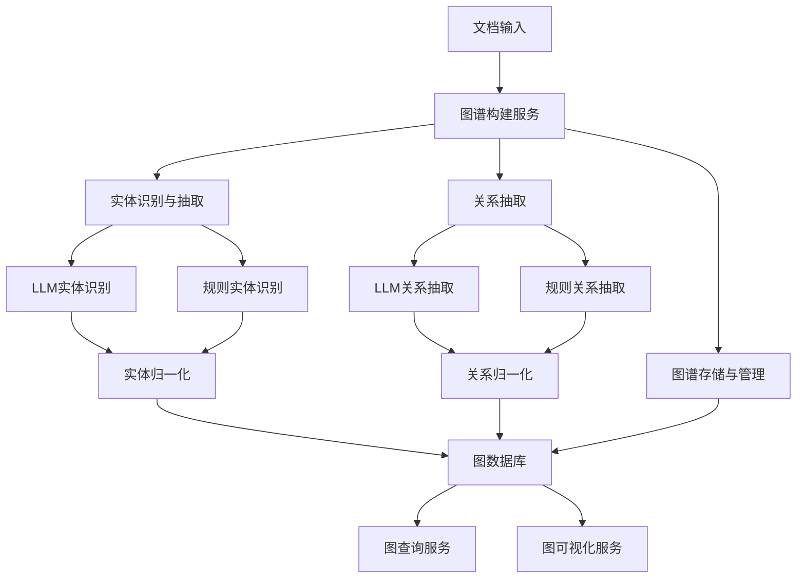
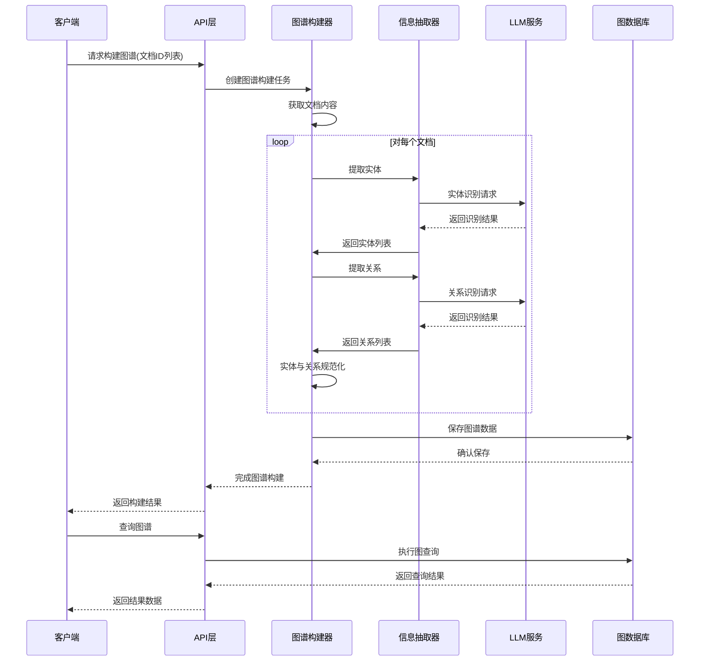
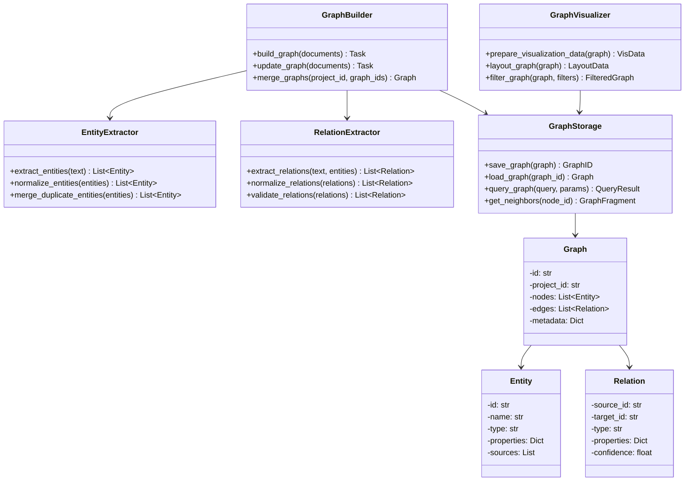
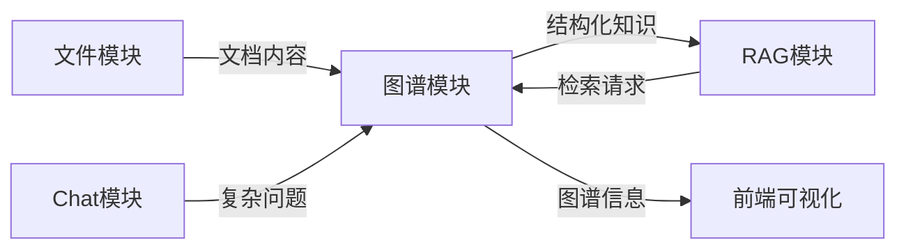

# Graph 知识图谱模块

## 概述

`graph` 模块是STP平台的知识图谱服务，负责从文档中提取实体和关系，构建结构化的知识图谱，支持复杂查询和语义理解。该模块将非结构化文本转化为结构化数据，为STP系统提供深度语义理解能力和可视化支持。

## 模块架构



## 处理流程



## 主要功能

- **实体识别与提取**：识别文档中的关键实体（人物、组织、产品、概念等）
- **关系抽取**：发现实体间的语义关系（如从属、包含、影响等）
- **图谱构建**：将提取的信息组织为结构化知识图谱
- **图查询**：支持高级图查询语言和模式匹配
- **可视化数据准备**：为前端图谱可视化提供数据支持
- **多文档图谱融合**：合并多个文档的图谱，构建全局知识网络
- **图谱更新与维护**：支持增量更新和图谱维护

## 主要组件



## 项目结构

```
graph/
├── routes/                # API路由定义
│   ├── api.py             # 主API路由
│   └── admin.py           # 管理API路由
├── services/              # 服务组件
│   ├── graph_builder.py   # 图谱构建服务
│   ├── entity_extractor.py# 实体抽取服务
│   ├── relation_extractor.py# 关系抽取服务
│   ├── graph_storage.py   # 图谱存储服务
│   └── graph_visualizer.py# 可视化数据准备
├── models/                # 模型定义
│   ├── entity.py          # 实体模型
│   ├── relation.py        # 关系模型
│   └── graph.py           # 图谱模型
├── config/                # 配置文件
│   └── settings.py        # 模块配置
├── prompts/               # LLM提示词
│   ├── entity_extraction.py # 实体提取提示词
│   └── relation_extraction.py # 关系提取提示词
└── Dockerfile             # 容器定义
```

## 实体与关系模型

知识图谱支持以下核心实体和关系类型：

### 常用实体类型

- **Person**: 人物实体
- **Organization**: 组织实体
- **Product**: 产品实体
- **Feature**: 功能/特性
- **Concept**: 概念/想法
- **Process**: 流程/过程
- **Location**: 地点/位置
- **Event**: 事件
- **Document**: 文档实体

### 常用关系类型

- **BELONGS_TO**: 从属关系
- **HAS_PART**: 包含关系
- **LOCATED_IN**: 位置关系
- **AFFECTS**: 影响关系
- **FOLLOWED_BY**: 时序关系
- **PRODUCED_BY**: 生产关系
- **RELATED_TO**: 一般关联关系

## API接口

### 构建知识图谱

```
POST /api/projects/{project_id}/graph/build
```

**请求参数**:
```json
{
  "file_ids": ["file123", "file456"],
  "options": {
    "entity_types": ["Person", "Organization", "Product"],
    "relation_types": ["BELONGS_TO", "HAS_PART"],
    "confidence_threshold": 0.7
  }
}
```

**响应**:
```json
{
  "task_id": "task_123456",
  "status": "processing",
  "message": "图谱构建已启动"
}
```

### 获取项目知识图谱

```
GET /api/projects/{project_id}/graph
```

**查询参数**:
- `include_properties`: 是否包含属性 (默认:true)
- `confidence_threshold`: 置信度阈值 (默认:0.5)
- `limit`: 限制返回节点数量 (默认:1000)

**响应**:
```json
{
  "nodes": [
    {
      "id": "n1",
      "name": "产品A",
      "type": "Product",
      "properties": { "model": "A100" },
      "confidence": 0.92
    },
    {
      "id": "n2",
      "name": "防滑功能",
      "type": "Feature",
      "properties": { "description": "提供优异的防滑性能" },
      "confidence": 0.87
    }
  ],
  "edges": [
    {
      "source": "n1",
      "target": "n2",
      "type": "HAS_FEATURE",
      "properties": { "importance": "high" },
      "confidence": 0.85
    }
  ],
  "metadata": {
    "node_count": 2,
    "edge_count": 1,
    "updated_at": "2023-05-15T08:30:00Z"
  }
}
```

### 执行图谱查询

```
POST /api/projects/{project_id}/graph/query
```

**请求参数**:
```json
{
  "query": "MATCH (p:Product)-[:HAS_FEATURE]->(f:Feature) WHERE f.name CONTAINS '防滑' RETURN p",
  "params": {},
  "options": {
    "limit": 100
  }
}
```

**响应**:
```json
{
  "results": [
    {
      "p": {
        "id": "n1",
        "name": "产品A",
        "type": "Product",
        "properties": { "model": "A100" }
      }
    }
  ],
  "metadata": {
    "execution_time_ms": 15,
    "row_count": 1
  }
}
```

### 获取节点相邻节点

```
GET /api/projects/{project_id}/graph/node/{node_id}/neighbors
```

**查询参数**:
- `depth`: 遍历深度 (默认:1)
- `direction`: 边方向 ["in", "out", "both"] (默认:"both")
- `edge_types`: 边类型筛选 (可选)

**响应**:
```json
{
  "nodes": [...],
  "edges": [...],
  "metadata": {
    "central_node_id": "n1",
    "depth": 1,
    "node_count": 5,
    "edge_count": 6
  }
}
```

## 与LLM集成

图谱模块通过LLM进行智能信息抽取，示例提示词：

```
# 实体抽取提示词
你是一个专业的实体识别专家。请从以下文本中识别所有重要实体，并按指定格式返回。
支持的实体类型: Person(人物), Organization(组织), Product(产品), Feature(特性), Concept(概念)

文本内容:
{text}

请按以下JSON格式返回识别的实体:
[
  {
    "name": "实体名称",
    "type": "实体类型",
    "properties": {"属性名": "属性值"},
    "mentions": ["文本中出现的位置"]
  }
]

# 关系抽取提示词
你是一个专业的关系抽取专家。已知以下实体，请识别它们之间的关系，并按指定格式返回。
支持的关系类型: BELONGS_TO(从属), HAS_PART(包含), AFFECTS(影响), PRODUCES(生产)

文本内容:
{text}

已识别的实体:
{entities}

请按以下JSON格式返回识别的关系:
[
  {
    "source": "源实体名称",
    "target": "目标实体名称",
    "type": "关系类型",
    "description": "关系描述",
    "confidence": 0.95
  }
]
```

## 部署方式

### Dockerfile

```dockerfile
FROM python:3.10-slim

# 安装系统依赖
RUN apt-get update && apt-get install -y \
    build-essential \
    && rm -rf /var/lib/apt/lists/*

# 设置工作目录
WORKDIR /app

# 复制项目文件
COPY requirements.txt .
COPY src/ /app/src/

# 安装Python依赖
RUN pip install --no-cache-dir -r requirements.txt

# 创建必要的目录
RUN mkdir -p /app/data/graph

# 设置环境变量
ENV PYTHONPATH=/app
ENV GRAPH_DB_URI=neo4j://neo4j:7687
ENV GRAPH_DB_USER=neo4j
ENV GRAPH_DB_PASSWORD=password
ENV SERVICE_AUTH_TOKEN=your-internal-auth-token

# 暴露端口
EXPOSE 8007

# 启动服务
CMD ["uvicorn", "src.modules.graph.main:app", "--host", "0.0.0.0", "--port", "8007"]
```

### 环境配置

在`.env`文件中设置：

```
# 图谱服务配置
GRAPH_SERVICE_PORT=8007
GRAPH_DB_TYPE=neo4j  # 或 arangodb, tigergraph

# Neo4j连接配置
NEO4J_URI=bolt://localhost:7687
NEO4J_USER=neo4j
NEO4J_PASSWORD=password

# 服务认证
SERVICE_AUTH_TOKEN=your-internal-auth-token

# 图谱构建配置
GRAPH_BUILD_BATCH_SIZE=5
GRAPH_DEFAULT_CONFIDENCE=0.7
GRAPH_USE_CACHE=true
```

## 与其他模块集成



### 与RAG模块集成

图谱模块为RAG提供结构化检索能力：
- 基于实体和关系的相关性搜索
- 通过图谱路径提供连贯上下文
- 支持基于知识图谱的多跳推理

### 与Chat模块集成

图谱支持Chat模块进行复杂问题处理：
- 提供实体关系上下文
- 支持多实体关联查询
- 解析复杂信息需求

### 与文件处理模块集成

图谱模块消费文件处理结果：
- 从处理后的文档中提取实体和关系
- 保持文档位置引用，支持溯源
- 识别跨文档实体关联

## 性能与扩展性

- **增量更新**: 支持增量添加新文档到现有图谱
- **分布式处理**: 支持大规模图谱的分布式构建
- **缓存机制**: 对频繁访问的子图实现缓存
- **图存储优化**: 针对不同规模的图数据选择合适的存储方案
- **并行处理**: 支持大规模图谱查询的并行处理

## 故障处理

常见问题及解决方案：

1. **图数据库连接失败**
   - 检查Neo4j服务状态
   - 验证连接凭据
   - 确认网络连通性

2. **实体提取质量问题**
   - 调整LLM提示词
   - 使用实体规范化规则
   - 提高置信度阈值

3. **图谱构建缓慢**
   - 增加处理并行度
   - 调整批处理大小
   - 监控资源使用情况 