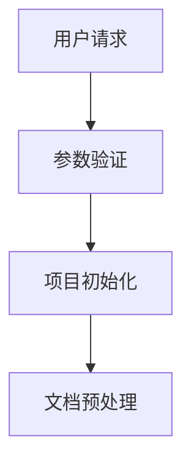
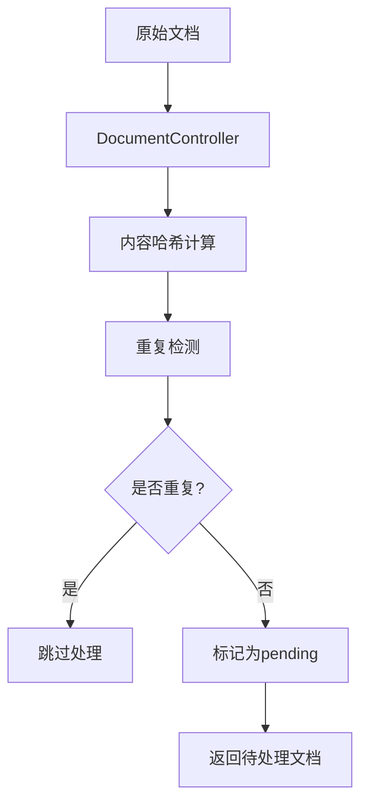
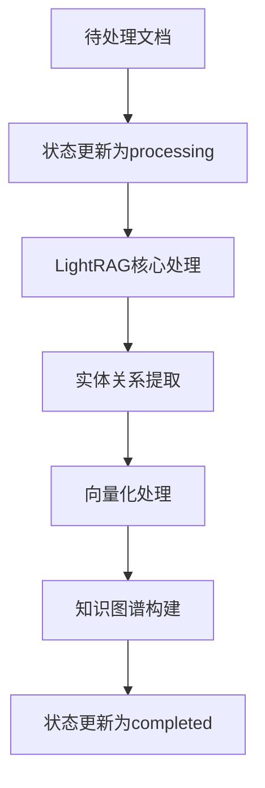

# LightRAG 文件处理逻辑详细说明

## 概述

LightRAG 服务是 STP 平台的核心知识图谱构建服务，负责将用户上传的文档转换为结构化的知识图谱，支持智能问答和知识检索。本文档详细说明文件处理的完整逻辑流程。

## 架构原理

### 核心设计理念

1. **用户文件驱动**: 所有处理都基于用户实际选择的文件，而非内部存储表
2. **项目级隔离**: 严格的多租户隔离，确保不同项目的数据完全分离
3. **统一工作空间**: 所有存储组件使用标准化的工作空间格式
4. **状态追踪**: 完整的文档处理状态管理和去重机制

### 工作空间标准化

所有存储组件都使用统一的工作空间格式：
```
stp_{project_id}_chunk_entity_relation
```

例如：`stp_project123_chunk_entity_relation`

## 文件处理完整流程

### 1. 请求接收与验证



**关键组件**: `lightrag_service.py:insert_documents()`

**处理步骤**:
1. 验证项目ID和文档数据
2. 获取项目独占锁，防止并发冲突
3. 初始化或复用LightRAG实例
4. 验证存储连接状态

**代码位置**: `src/modules/lightraglocal/services/lightrag_service.py:1420-1450`

### 2. 文档控制器预处理



**关键组件**: `document_controller.py:prepare_documents_for_processing()`

**核心逻辑**:
- 为每个文档计算SHA256内容哈希
- 在`project_document_processing`表中检查重复性
- 基于`file_id`和`content_hash`进行去重
- 将新文档标记为`pending`状态

**数据库表结构**:
```sql
CREATE TABLE project_document_processing (
    id SERIAL PRIMARY KEY,
    project_id VARCHAR(255) NOT NULL,
    file_id VARCHAR(255) NOT NULL,
    file_path TEXT,
    content_hash VARCHAR(64),
    processing_status VARCHAR(50) DEFAULT 'pending',
    lightrag_doc_id VARCHAR(255),
    processed_at TIMESTAMP,
    created_at TIMESTAMP DEFAULT CURRENT_TIMESTAMP,
    updated_at TIMESTAMP DEFAULT CURRENT_TIMESTAMP,
    UNIQUE(project_id, file_id),
    UNIQUE(project_id, content_hash)
);
```

### 3. LightRAG 批量处理



**关键组件**: `lightrag_service.py:_process_documents_batch()`

**处理步骤**:
1. 将文档状态更新为`processing`
2. 调用LightRAG核心引擎进行处理
3. 执行实体识别和关系抽取
4. 生成文档向量化表示
5. 构建和更新知识图谱
6. 将状态更新为`completed`

### 4. 存储层统一处理

#### 4.1 KV存储 (文档和缓存)

**组件**: `unified_kv_storage.py`

**功能**:
- 存储原始文档内容
- LLM响应缓存
- 文本分块数据

**关键特性**:
- 使用WorkspaceStandardizer统一格式化
- 自动修复SQL模板中的namespace问题
- 支持项目级数据隔离

#### 4.2 向量存储 (实体和关系)

**组件**: `unified_vector_storage.py`

**功能**:
- 存储实体向量
- 存储关系向量
- 支持语义搜索

**关键特性**:
- 自动检测存储类型（entity/relationship）
- 传递标准化namespace给父类
- 修复workspace格式bug（避免`stp_X_chunk_entity_relationchunks`）

#### 4.3 图存储 (知识图谱)

**组件**: `neo4j_project_isolation.py`

**功能**:
- 存储实体节点
- 存储关系边
- 支持图查询

**关键特性**:
- 项目级Neo4j数据库隔离
- 自动创建项目专用数据库
- Hook机制拦截所有图操作

### 5. 工作空间管理器

**组件**: `workspace_manager.py`

**核心类**: `WorkspaceStandardizer`

**功能**:
- 统一工作空间格式标准化
- 自动检测和修复格式不一致
- 提供项目ID提取和验证

**主要方法**:
```python
@classmethod
def standardize(cls, input_namespace: str, fallback_project_id: Optional[str] = None) -> str:
    """标准化工作空间格式为 stp_{project_id}_chunk_entity_relation"""

@classmethod  
def extract_project_id(cls, workspace: str) -> Optional[str]:
    """从工作空间中提取项目ID"""

@classmethod
def is_standard_format(cls, workspace: str) -> bool:
    """检查是否为标准格式"""
```

## 数据流示例

### 单文件处理流程

```
用户选择: [file_001.txt]
     ↓
DocumentController: 计算哈希 → 检查重复 → 标记pending
     ↓
LightRAG处理: 状态→processing → 实体抽取 → 关系构建 → 状态→completed  
     ↓
存储分发:
├─ KV存储: lightrag_doc_full (原文)
├─ 向量存储: lightrag_vdb_entity, lightrag_vdb_relation (向量)
└─ 图存储: Neo4j nodes & edges (图谱)
     ↓
结果返回: {user_files: 1, processed_files: 1, inserted_count: 1}
```

### 多文件处理流程

```
用户选择: [file_001.txt, file_002.txt, file_003.txt]
     ↓
DocumentController: 
├─ file_001.txt → 新文档 → pending
├─ file_002.txt → 重复 → 跳过  
└─ file_003.txt → 新文档 → pending
     ↓
LightRAG批量处理: [file_001.txt, file_003.txt]
     ↓
结果返回: {user_files: 3, processed_files: 2, inserted_count: 2, duplicate_count: 1}
```

## 关键配置参数

### 数据库连接

```python
DATABASE_CONFIG = {
    "host": "localhost",
    "port": 5432, 
    "user": "stpuser",
    "password": "stppassword",
    "database": "stpdb"
}
```

### LLM配置

```python
LLM_CONFIG = {
    "gateway_url": "http://localhost:8888",
    "default_model": "deepseek-chat",
    "timeout": 120.0
}
```

### 向量化配置

```python
EMBEDDING_CONFIG = {
    "provider": "ollama",
    "endpoint": "http://localhost:11434", 
    "model": "bge-m3:latest",
    "dimension": 1024
}
```

## 错误处理机制

### 1. 数据库类型一致性

**问题**: AsyncPG参数类型推断错误
**解决**: 强制类型转换确保参数一致性

```python
status_val = str(status)
doc_id_val = str(lightrag_doc_id) if lightrag_doc_id is not None else None
project_id_val = str(project_id)
file_id_val = str(file_id)
```

### 2. 工作空间格式修复

**问题**: 不同存储组件使用不一致的namespace格式
**解决**: WorkspaceStandardizer统一标准化

```python
standardized_workspace = WorkspaceStandardizer.standardize(
    original_namespace, project_id
)
```

### 3. 重复处理防护

**问题**: 同一文档被重复处理
**解决**: 基于内容哈希的去重机制

```python
content_hash = hashlib.sha256(content.encode('utf-8')).hexdigest()
existing = await conn.fetchrow("""
    SELECT processing_status FROM project_document_processing 
    WHERE project_id = $1 AND (file_id = $2 OR content_hash = $3)
""", project_id, file_id, content_hash)
```

## 性能优化策略

### 1. 连接池管理

- 使用asyncpg连接池减少连接开销
- 每个项目维护独立的LightRAG实例缓存
- Neo4j驱动连接复用

### 2. 批量处理

- 文档批量插入减少I/O次数
- 向量批量计算提高效率
- 图操作事务优化

### 3. 缓存机制

- LLM响应缓存避免重复调用
- 实体关系缓存加速查询
- 工作空间验证结果缓存

## 监控和日志

### 关键监控指标

1. **处理性能**: 文档处理时间、吞吐量
2. **存储状态**: 各存储组件健康状态  
3. **错误率**: 处理失败率、重试次数
4. **资源使用**: 内存、CPU、数据库连接数

### 日志级别

- **INFO**: 正常处理流程和状态更新
- **WARNING**: 可恢复的错误和异常情况
- **ERROR**: 严重错误需要人工干预
- **DEBUG**: 详细的调试信息

### 示例日志输出

```
INFO:src.modules.lightraglocal.services.lightrag_service:🔧 开始基于用户选择的 1 个文件进行处理 (项目: test_project)
INFO:src.modules.lightraglocal.services.document_controller:✅ 准备处理新文档: file_001 (哈希: 45df84858010...)
INFO:src.modules.lightraglocal.services.lightrag_service:🚀 开始处理 1 个新文档到LightRAG (项目: test_project)
INFO:src.modules.lightraglocal.services.lightrag_service:✅ LightRAG处理完成，文档已成功插入并完成实体关系提取
INFO:src.modules.lightraglocal.services.document_controller:📋 更新文档状态: file_001 -> completed
```

## 故障排除指南

### 常见问题

1. **数据库连接失败**
   - 检查PostgreSQL和Neo4j服务状态
   - 验证连接配置和权限

2. **工作空间格式错误**  
   - 检查WorkspaceStandardizer是否正确初始化
   - 验证项目ID格式是否合规

3. **文档处理卡住**
   - 检查LLM服务连接状态
   - 查看处理队列和锁状态

4. **向量存储错误**
   - 验证pgvector扩展是否安装
   - 检查表空间和权限

### 调试命令

```bash
# 检查服务健康状态
curl http://localhost:8006/healthz

# 查看处理统计
curl http://localhost:8006/api/rag/status/{project_id}

# 检查数据库状态
python scripts/diagnose_services.py
```

## 未来优化方向

1. **性能提升**
   - 异步处理管道优化
   - 向量计算GPU加速
   - 分布式处理支持

2. **功能增强**
   - 增量更新机制
   - 多模态文档支持
   - 实时知识图谱更新

3. **运维改进**
   - 自动化监控告警
   - 性能分析工具
   - 容错和恢复机制