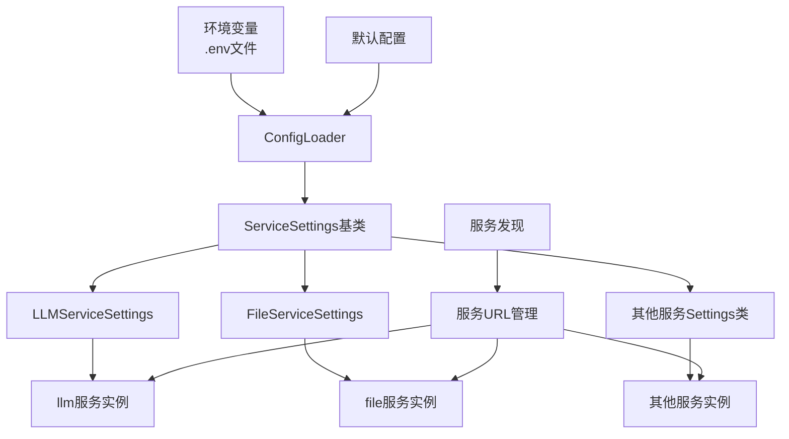
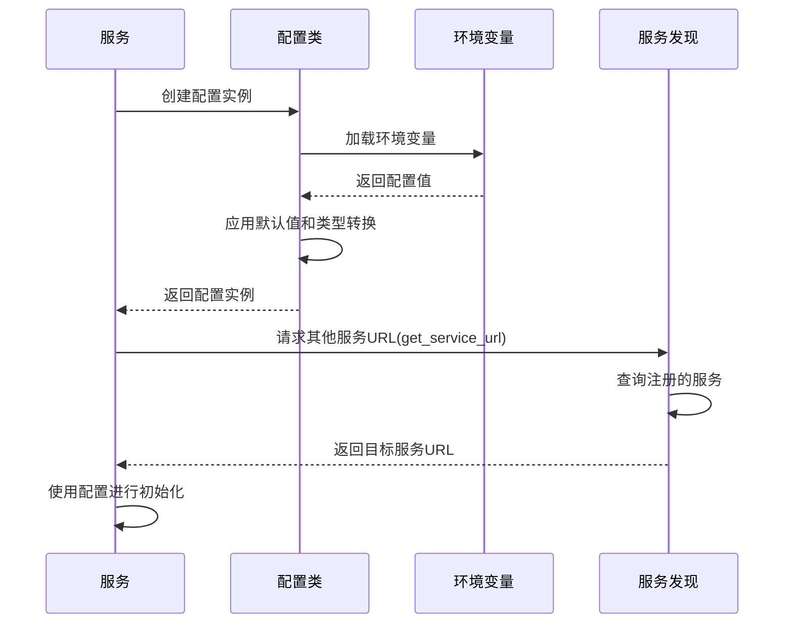
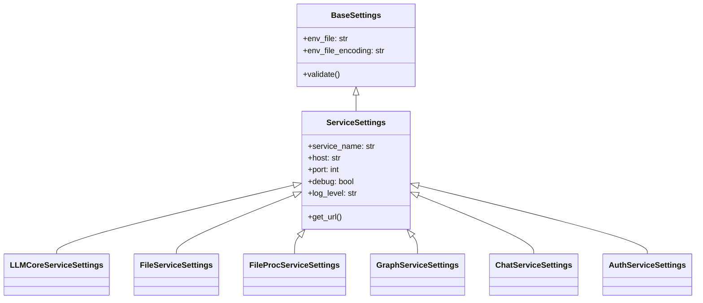
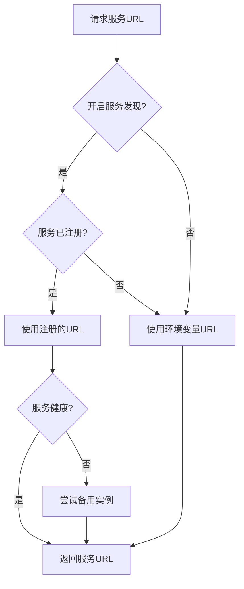

# 统一配置管理系统

本模块提供了STP平台的统一配置管理功能，用于替代微服务中的分散配置文件和硬编码配置值，确保所有服务使用一致的配置接口和管理方式。

## 配置系统架构



## 特性

- **统一配置来源**: 从`.env`文件和环境变量加载配置
- **类型安全**: 基于Pydantic的类型验证和转换
- **服务标准化**: 各微服务使用相同的配置结构和接口
- **多环境支持**: 开发、测试和生产环境配置分离
- **服务发现集成**: 自动获取其他服务的URL和端口
- **配置继承**: 通过基类实现配置复用和继承

## 目录结构

```
src/shared/config/
├── __init__.py          # 导出所有配置类和工具函数
├── config_loader.py     # 配置加载工具
├── service_config.py    # 服务URL和端口管理
├── service_settings.py  # 微服务配置类定义
├── settings.py          # 基础配置类
└── README.md            # 使用文档
```

## 使用流程



## 使用方法

### 1. 在微服务中使用标准配置类

每个微服务都有对应的配置类，比如`LLMCoreServiceSettings`、`FileServiceSettings`等。

```python
# 在微服务模块中使用配置类
from src.shared.config import LLMCoreServiceSettings

# 创建设置实例，自动从.env加载
settings = LLMCoreServiceSettings()

# 访问配置
port = settings.port
api_key = settings.api_key
```

### 2. 通过工具函数获取环境变量

如果只需要获取单个环境变量，可以使用`get_env`函数：

```python
from src.shared.config import get_env

# 获取环境变量，提供默认值和类型转换
debug = get_env("DEBUG", False, env_type=bool)
port = get_env("APP_PORT", 8000, env_type=int)
api_url = get_env("API_URL", "http://localhost:8080")
```

### 3. 获取服务URL

使用服务发现获取其他服务的URL、主机和端口：

```python
from src.shared.config import get_service_url, get_service_host, get_service_port

# 获取服务的URL
llm_url = get_service_url("llm")
file_service_url = get_service_url("file")

# 获取服务主机和端口
host = get_service_host("graph")
port = get_service_port("fileproc")
```

### 4. 创建自定义配置模型

可以创建特定功能的配置模型，以获得类型安全和IDE支持：

```python
from src.shared.config.settings import BaseSettings
from pydantic import Field

class OCRSettings(BaseSettings):
    """OCR处理配置"""
    enable_ocr: bool = Field(default_factory=lambda: get_env("ENABLE_OCR", False, env_type=bool))
    models_path: str = Field(default_factory=lambda: get_env("OCR_MODELS_PATH", "./models"))
    use_gpu: bool = Field(default_factory=lambda: get_env("USE_GPU_OCR", False, env_type=bool))
    
    class Config:
        env_prefix = "OCR_"
```

## 配置类层次结构



## 开发指南

### 添加新的服务配置类

1. 在`service_settings.py`中创建新的配置类
2. 继承`ServiceSettings`基类
3. 在`__init__.py`中导出新类

```python
# service_settings.py
from pydantic import Field
from .settings import ServiceSettings
from .config_loader import get_env

class NewServiceSettings(ServiceSettings):
    """新服务的配置类"""
    service_name: str = "new_service"
    port: int = Field(default_factory=lambda: get_env("NEW_SERVICE_PORT", 8099, env_type=int))
    
    # 其他特定配置...
    api_key: str = Field(default_factory=lambda: get_env("NEW_SERVICE_API_KEY", ""))
    timeout: int = Field(default_factory=lambda: get_env("NEW_SERVICE_TIMEOUT", 30, env_type=int))
    
    class Config:
        env_prefix = "NEW_SERVICE_"
```

### 环境变量命名规范

遵循以下命名规范确保配置一致性：

| 变量类型 | 命名格式 | 示例 |
|---------|---------|------|
| 服务端口 | `{SERVICE_NAME}_SERVICE_PORT` | `FILE_SERVICE_PORT` |
| 服务主机 | `{SERVICE_NAME}_SERVICE_HOST` | `LLM_SERVICE_HOST` |
| 特定配置 | `{SERVICE_NAME}_{CONFIG_NAME}` | `LLM_API_KEY` |
| 调试开关 | `{SERVICE_NAME}_DEBUG` | `FILE_DEBUG` |
| 日志级别 | `{SERVICE_NAME}_LOG_LEVEL` | `AUTH_LOG_LEVEL` |

## 最佳实践

1. **配置中心化**
   - 所有配置定义在`shared/config`目录
   - 禁止在微服务中创建独立配置类

2. **类型安全**
   - 使用`env_type`参数指定环境变量类型
   - 使用Pydantic字段类型声明确保类型安全

3. **默认值**
   - 为所有配置提供合理的默认值
   - 默认值应允许服务在最小配置下运行

4. **服务链接**
   - 使用`get_service_url`获取其他服务地址
   - 禁止硬编码服务URL或端口

5. **敏感信息**
   - 敏感配置必须从环境变量获取
   - 避免将密钥等敏感信息硬编码或提交到版本控制

## 环境变量加载流程

1. 首先尝试从**环境变量**读取值
2. 如果环境变量不存在，尝试从**.env文件**读取
3. 如果.env文件没有对应值，使用**代码中的默认值**
4. 应用**类型转换**，确保值类型符合预期
5. 如果值无效且无默认值，**抛出错误**

## 服务URL获取策略



## 配置系统核心代码

src/shared/config/config_loader.py:
```python
def get_env(env_name: str, default: Any = None, env_type: Any = str) -> Any:
    """
    从环境变量获取配置值，支持类型转换
    
    Args:
        env_name: 环境变量名称
        default: 默认值，环境变量不存在时返回
        env_type: 期望的值类型，用于类型转换
        
    Returns:
        转换为期望类型的环境变量值或默认值
    """
    value = os.environ.get(env_name)
    if value is None:
        return default
        
    # 根据期望类型进行转换
    if env_type == bool:
        return value.lower() in ("true", "1", "yes", "y", "t")
    elif env_type == int:
        return int(value)
    elif env_type == float:
        return float(value)
    elif env_type == list:
        return value.split(",") if value else []
    else:
        return value  # 默认为字符串
``` 